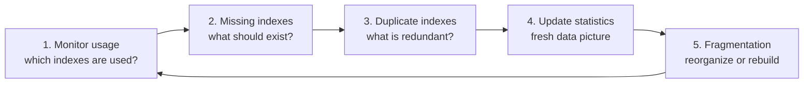
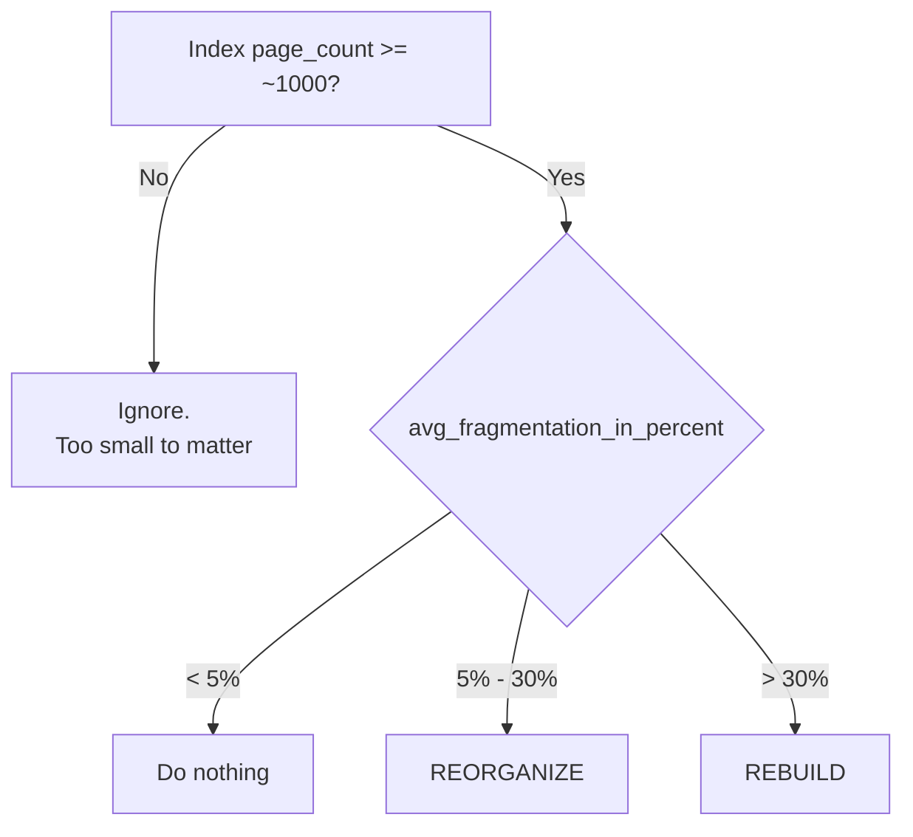

# SQL Index Maintenance & Monitoring (T-SQL / SQL Server)

> How to check which indexes are used, find missing and duplicate ones, keep statistics fresh, and fix fragmentation.

---

## Table of Contents

1. [Why indexes need maintenance](#1-why-indexes-need-maintenance)
2. [The maintenance cycle](#2-the-maintenance-cycle)
3. [Monitor index usage](#3-monitor-index-usage)
4. [Monitor missing indexes](#4-monitor-missing-indexes)
5. [Monitor duplicate indexes](#5-monitor-duplicate-indexes)
6. [Update statistics](#6-update-statistics)
7. [Fragmentation: detect and fix](#7-fragmentation-detect-and-fix)
8. [Reorganize vs Rebuild](#8-reorganize-vs-rebuild)
9. [Automating it (and the Express catch)](#9-automating-it)
10. [Common gotchas](#10-common-gotchas)
11. [Cheat sheet](#11-cheat-sheet)

---

## 1. Why indexes need maintenance

An index is not "create once, forget". Over time:

| Problem                                   | Cause                                           | Effect                                         |
| ----------------------------------------- | ----------------------------------------------- | ---------------------------------------------- |
| **Unused indexes**                  | Queries changed, or the index never helped      | Waste disk and slow every INSERT/UPDATE/DELETE |
| **Missing indexes**                 | New queries with no supporting index            | Table scans, slow queries                      |
| **Duplicate / overlapping indexes** | Different people created the same index         | Double the write cost and storage for nothing  |
| **Stale statistics**                | Data changed but the optimizer's picture didn't | Bad execution plans                            |
| **Fragmentation**                   | Page splits, deletes, row growth                | Wasted space, more page reads, slower scans    |

---

## 2. The maintenance cycle



Run the cycle regularly (weekly or monthly for most systems), not once.

---

## 3. Monitor index usage

### 3.1 List the indexes on a table

```sql
EXEC sp_helpindex 'Sales.Orders';
```

Shows each index name, description (clustered / unique / nonclustered) and its key columns. Note that it does **not** show included columns or filters. For those, use the catalog views (`sys.indexes`, `sys.index_columns`).

### 3.2 How often is each index used?

The DMV `sys.dm_db_index_usage_stats` records what happened to each index since the SQL Server service last started.

```sql
SELECT
    tbl.name           AS tableName,
    idx.name           AS indexName,
    idx.type_desc      AS indexType,
    idx.is_primary_key AS isPrimaryKey,
    idx.is_unique      AS isUnique,
    idx.is_disabled    AS isDisabled,
    s.user_seeks,
    s.user_scans,
    s.user_lookups,
    s.user_updates,
    s.last_user_seek,
    s.last_user_scan
FROM sys.indexes AS idx
JOIN sys.tables  AS tbl
  ON idx.object_id = tbl.object_id
LEFT JOIN sys.dm_db_index_usage_stats AS s
  ON  s.object_id   = idx.object_id
  AND s.index_id    = idx.index_id
  AND s.database_id = DB_ID()          -- <-- add this (see note below)
ORDER BY tbl.name, idx.name;
```

> **Fix to your query:** the DMV covers *all* databases on the server. Without `s.database_id = DB_ID()`, an `object_id` in your database can accidentally match the same number from another database and show wrong usage numbers.

### 3.3 What the columns mean

| Column                                  | Meaning                                                                                    | Counts when...                                  |
| --------------------------------------- | ------------------------------------------------------------------------------------------ | ----------------------------------------------- |
| `user_seeks`                          | Index used to jump straight to specific rows                                               | A query does an index **seek**            |
| `user_scans`                          | Index read from start to end                                                               | A query does an index (or table) **scan** |
| `user_lookups`                        | Extra trip from a non-clustered index to the clustered index / heap to fetch other columns | A **key / RID lookup**                    |
| `user_updates`                        | Index had to be modified                                                                   | Any INSERT / UPDATE / DELETE touching it        |
| `last_user_seek` / `last_user_scan` | When it was last used                                                                      |                                                 |

```
 Reads  = user_seeks + user_scans + user_lookups     (benefit)
 Writes = user_updates                               (cost)

 Healthy index:   reads  >>  writes
 Suspect index:   reads  =  0   and  writes  high    ->  paying cost, getting nothing
```

### 3.4 Reading the results

| What you see                                       | What it likely means                                                                                    |
| -------------------------------------------------- | ------------------------------------------------------------------------------------------------------- |
| `NULL` in all usage columns (from the LEFT JOIN) | Not used since the last restart. SQL Server has no record at all                                        |
| Seeks high, updates low                            | Great index, keep                                                                                       |
| Reads 0, updates high                              | Candidate to drop or disable                                                                            |
| Scans high, seeks 0                                | Index is being scanned, not searched. Maybe the wrong key column, or the queries need a different index |
| Lookups very high                                  | A covering index (`INCLUDE`) may remove the extra trips                                               |
| `idx.name` is NULL                               | That row is a **heap** (table without a clustered index)                                          |

### 3.5 Quick demo

The counters only change after queries run:

```sql
SELECT * FROM Sales.Orders WHERE OrderStatus = 'Delivered';

SELECT * FROM sys.dm_db_index_usage_stats
WHERE database_id = DB_ID()
  AND object_id   = OBJECT_ID('Sales.Orders');
```

Run the query a few times and watch `user_seeks` or `user_scans` go up. Which one increases tells you whether the optimizer used a seek or a scan.

### 3.6 Find unused-index candidates

```sql
SELECT
    OBJECT_SCHEMA_NAME(i.object_id) AS SchemaName,
    OBJECT_NAME(i.object_id)        AS TableName,
    i.name                          AS IndexName,
    i.type_desc,
    ISNULL(s.user_updates, 0)       AS Writes,
    ISNULL(s.user_seeks + s.user_scans + s.user_lookups, 0) AS Reads
FROM sys.indexes i
LEFT JOIN sys.dm_db_index_usage_stats s
  ON s.object_id = i.object_id AND s.index_id = i.index_id AND s.database_id = DB_ID()
WHERE i.type_desc = 'NONCLUSTERED'
  AND i.is_primary_key      = 0
  AND i.is_unique_constraint = 0
  AND i.is_unique           = 0
  AND OBJECTPROPERTY(i.object_id, 'IsUserTable') = 1
  AND ISNULL(s.user_seeks + s.user_scans + s.user_lookups, 0) = 0
ORDER BY Writes DESC;
```

**Before dropping anything:**

- The counters **reset when the SQL Server service restarts**. An index that looks unused may just serve a monthly or quarterly report that hasn't run yet. Check after a full business cycle.
- I excluded unique indexes and PK/unique constraints on purpose: they enforce rules even if no query "reads" them.
- Safer first step: `ALTER INDEX idx ON tbl DISABLE;`, wait, then drop if nothing complains. Disabling keeps the definition, so `REBUILD` brings it back.

---

## 4. Monitor missing indexes

While compiling plans, the optimizer notes indexes that *would have* helped and stores them in DMVs.

```sql
SELECT * FROM sys.dm_db_missing_index_details;
```

That view alone is hard to rank. It's normally joined with the two related DMVs so you can see **how much** each suggestion would help:

```sql
SELECT TOP 20
    ROUND(s.avg_total_user_cost * s.avg_user_impact * (s.user_seeks + s.user_scans), 0) AS improvement_measure,
    d.statement            AS table_name,
    d.equality_columns,
    d.inequality_columns,
    d.included_columns,
    s.user_seeks,
    s.user_scans,
    s.avg_user_impact      AS est_pct_improvement,
    s.last_user_seek
FROM sys.dm_db_missing_index_details     AS d
JOIN sys.dm_db_missing_index_groups      AS g ON g.index_handle = d.index_handle
JOIN sys.dm_db_missing_index_group_stats AS s ON s.group_handle = g.index_group_handle
WHERE d.database_id = DB_ID()
ORDER BY improvement_measure DESC;
```

| Column                          | Meaning                                                       |
| ------------------------------- | ------------------------------------------------------------- |
| `equality_columns`            | Columns used with `=` in WHERE/JOIN                         |
| `inequality_columns`          | Columns used with `<`, `>`, `BETWEEN`, `<>`           |
| `included_columns`            | Extra columns the query selected (candidates for `INCLUDE`) |
| `avg_user_impact`             | Estimated % cost reduction if the index existed               |
| `user_seeks` / `user_scans` | How many times the optimizer wanted it                        |

Turning a suggestion into an index: **equality columns first, then inequality columns as keys, the rest in `INCLUDE`**.

```sql
-- equality_columns:   [CustomerID]
-- inequality_columns: [OrderDate]
-- included_columns:   [Sales]
CREATE NONCLUSTERED INDEX idx_Orders_CustomerID_OrderDate
ON Sales.Orders (CustomerID, OrderDate)
INCLUDE (Sales);
```

**Treat these as hints, not orders:**

- The suggestions ignore the **existing** indexes, so you may be told to create something that nearly exists already.
- They are not ranked by write cost, don't suggest filtered or columnstore indexes, and the column order isn't always optimal.
- The list is **cleared on restart**, and holds a limited number of entries.
- Always merge overlapping suggestions into one index, test the query before and after, and check the write impact.

---

## 5. Monitor duplicate indexes

Two indexes with the same key columns do the same job, but both must be updated on every write.

```
 IX_Orders_CustomerID           (CustomerID)
 IX_Orders_CustomerID_copy      (CustomerID)          <- exact duplicate: drop one
 IX_Orders_CustID_OrderDate     (CustomerID, OrderDate)  <- overlap: makes (CustomerID) alone redundant
```

### 5.1 Exact duplicates (same keys, same includes)

```sql
WITH IndexDef AS (
    SELECT
        i.object_id,
        i.index_id,
        i.name,
        i.is_unique,
        ISNULL(i.filter_definition, '') AS filter_definition,
        STRING_AGG(CASE WHEN ic.is_included_column = 0 THEN c.name END, ',')
            WITHIN GROUP (ORDER BY ic.key_ordinal) AS KeyCols,
        ISNULL(STRING_AGG(CASE WHEN ic.is_included_column = 1 THEN c.name END, ',')
            WITHIN GROUP (ORDER BY c.name), '')    AS IncludedCols
    FROM sys.indexes i
    JOIN sys.index_columns ic ON ic.object_id = i.object_id AND ic.index_id = i.index_id
    JOIN sys.columns c        ON c.object_id  = ic.object_id AND c.column_id = ic.column_id
    WHERE i.type IN (1, 2)                       -- clustered / nonclustered rowstore
      AND OBJECTPROPERTY(i.object_id, 'IsUserTable') = 1
    GROUP BY i.object_id, i.index_id, i.name, i.is_unique, i.filter_definition
)
SELECT
    OBJECT_SCHEMA_NAME(a.object_id) AS SchemaName,
    OBJECT_NAME(a.object_id)        AS TableName,
    a.name AS IndexA,
    b.name AS IndexB,
    a.KeyCols,
    a.IncludedCols
FROM IndexDef a
JOIN IndexDef b
  ON  a.object_id        = b.object_id
  AND a.index_id         < b.index_id
  AND a.KeyCols          = b.KeyCols
  AND a.IncludedCols     = b.IncludedCols
  AND a.filter_definition = b.filter_definition;
```

### 5.2 Overlapping indexes (one is the "left prefix" of another)

An index on `(CustomerID)` is usually redundant if `(CustomerID, OrderDate)` exists, because the second one can serve any query the first one can. Adjust the join above to:

```sql
AND b.KeyCols LIKE a.KeyCols + ',%'
```

and review the pairs by hand.

### 5.3 Which one to drop?

- Keep the one backing a **primary key** or **unique constraint** (drop the other).
- If one is `UNIQUE` and the other isn't, keep the unique one.
- Check `sys.dm_db_index_usage_stats` (section 3): drop the one with fewer reads, or disable it first.
- Never drop an index if a query uses an **index hint** (`WITH (INDEX(name))`): the query would then fail.

---

## 6. Update statistics

**Statistics** are small summaries (a histogram of value distribution plus row counts) the optimizer uses to estimate how many rows a filter will return, and therefore which plan to pick (seek vs scan, which join type...).

```
 Statistics say:  "OrderStatus = 'Delivered' matches ~2% of rows"
        optimizer ->  use the index (seek)

 Stale statistics say the same, but the data changed and it's now 60%
        optimizer ->  still picks seek, but a scan would have been far faster
```

### 6.1 Check how fresh they are

```sql
SELECT
    s.name                AS StatisticsName,
    sp.last_updated,
    sp.rows,
    sp.rows_sampled,
    sp.modification_counter     -- rows changed since last update
FROM sys.stats s
CROSS APPLY sys.dm_db_stats_properties(s.object_id, s.stats_id) sp
WHERE s.object_id = OBJECT_ID('Sales.Orders');
```

A large `modification_counter` relative to `rows` suggests the statistics are stale.

### 6.2 Update them

```sql
UPDATE STATISTICS Sales.Orders;                           -- all stats on the table
UPDATE STATISTICS Sales.Orders idx_orders_orderstatus;    -- one index/stat
UPDATE STATISTICS Sales.Orders WITH FULLSCAN;             -- read every row (accurate, slower)
UPDATE STATISTICS Sales.Orders WITH SAMPLE 50 PERCENT;    -- sample

EXEC sp_updatestats;                                      -- whole database (only stale ones)
```

### 6.3 Things to know

- By default the database has **auto-update statistics** on: SQL Server refreshes them itself once enough rows change. On big tables that threshold can still be too lax, so a scheduled update helps.
- `ALTER INDEX ... REBUILD` updates that index's statistics with the equivalent of a full scan. **`REORGANIZE` does not update statistics**, so do it separately.
- Don't run both a rebuild and a manual `UPDATE STATISTICS` on the same index. It's redundant (and a lower-quality sample can overwrite the full-scan one).
- After changing statistics, cached plans get recompiled, so expect a short bump in compile time.

---

## 7. Fragmentation: detect and fix

### 7.1 Two kinds of fragmentation

```
 Healthy:   pages are full and in logical order
 ┌────┐ ┌────┐ ┌────┐ ┌────┐
 │ 1  │→│ 2  │→│ 3  │→│ 4  │      each page ~100% full, next page is physically next
 │████│ │████│ │████│ │████│
 └────┘ └────┘ └────┘ └────┘

 External (logical) fragmentation: pages are OUT OF ORDER
 ┌────┐ ┌────┐ ┌────┐ ┌────┐
 │ 1  │ │ 3  │ │ 2  │ │ 4  │      reading 1→2→3→4 jumps around the file
 └────┘ └────┘ └────┘ └────┘

 Internal fragmentation: UNUSED SPACE inside pages
 ┌────┐ ┌────┐ ┌────┐ ┌────┐
 │██  │ │███ │ │█   │ │██  │      same data now needs more pages -> more reads, more memory
 └────┘ └────┘ └────┘ └────┘
```

Your notes: "unused spaces in data pages" = internal fragmentation; "data pages are out of order" = external fragmentation.

**What causes it**

- **Page splits**: inserting into a full page in the middle of an index (random keys such as `NEWID()` GUIDs) forces SQL Server to split it into two half-full pages, usually out of order.
- **Deletes** leave gaps in pages.
- **Updates that make a row bigger** (e.g. a `VARCHAR` growing) can push it off the page.

### 7.2 Measure it

```sql
SELECT
    OBJECT_SCHEMA_NAME(ps.object_id) AS SchemaName,
    OBJECT_NAME(ps.object_id)        AS TableName,
    i.name                           AS IndexName,
    ps.index_type_desc,
    ps.avg_fragmentation_in_percent,
    ps.page_count
FROM sys.dm_db_index_physical_stats
        (DB_ID(), OBJECT_ID('Sales.Orders'), NULL, NULL, 'LIMITED') AS ps
JOIN sys.indexes i
  ON i.object_id = ps.object_id AND i.index_id = ps.index_id
WHERE ps.index_id > 0                         -- skip heaps
ORDER BY ps.avg_fragmentation_in_percent DESC;
```

| Mode                  | Cost                              | Gives                                                   |
| --------------------- | --------------------------------- | ------------------------------------------------------- |
| `LIMITED` (default) | Cheapest, reads only upper levels | `avg_fragmentation_in_percent`, `page_count`        |
| `SAMPLED`           | Medium                            | Adds `avg_page_space_used_in_percent` (page fullness) |
| `DETAILED`          | Reads everything                  | Full detail, slow on big tables                         |

### 7.3 When to act (widely used rule of thumb)



Small indexes (a few hundred pages or fewer) show high fragmentation percentages because of how pages are allocated, and fixing them achieves nothing.

### 7.4 Fix it

```sql
-- Light: defragment the leaf level, keep it sorted
ALTER INDEX idx_Orders_CustomerID ON Sales.Orders REORGANIZE;

-- Heavy: drop and recreate the index from scratch
ALTER INDEX idx_Orders_CustomerID ON Sales.Orders REBUILD;

-- All indexes on a table
ALTER INDEX ALL ON Sales.Orders REBUILD;

-- Rebuild with options
ALTER INDEX idx_Orders_CustomerID ON Sales.Orders
REBUILD WITH (FILLFACTOR = 90, SORT_IN_TEMPDB = ON);

-- A heap has no index to rebuild: rebuild the table
ALTER TABLE Sales.Orders_Heap REBUILD;
```

**`FILLFACTOR`** leaves free space on each leaf page when the index is built, so future inserts have room and cause fewer page splits. `90` means "fill pages 90%". Use lower values (80-90) on tables with heavy random inserts or updates. Leave it at the default (100) for read-mostly or append-only tables.

---

## 8. Reorganize vs Rebuild

|                                        | **REORGANIZE**                                        | **REBUILD**                                                                                                        |
| -------------------------------------- | ----------------------------------------------------------- | ------------------------------------------------------------------------------------------------------------------------ |
| What it does                           | Reorders the existing leaf pages in place and compacts them | Creates a brand-new copy of the index and drops the old one                                                              |
| Weight                                 | Light                                                       | Heavy                                                                                                                    |
| Online?                                | Always online, never blocks the table                       | Offline by default (locks the table); `ONLINE = ON` only in editions that support it (e.g. Enterprise). Not on Express |
| Can be interrupted?                    | Yes, progress is kept                                       | No, a cancelled rebuild rolls back                                                                                       |
| Transaction log                        | Small, in batches                                           | Large (can be big in FULL recovery model)                                                                                |
| Updates statistics?                    | **No**                                                | **Yes** (full-scan quality)                                                                                        |
| Can change options (e.g. fill factor)? | No                                                          | Yes                                                                                                                      |
| Fixes                                  | Light external fragmentation, compacts pages                | All fragmentation, and resets page density                                                                               |
| Use when                               | Fragmentation 5-30%                                         | Fragmentation > 30%                                                                                                      |

```
 REORGANIZE                              REBUILD
 ┌──┐┌──┐┌──┐┌──┐                        old index         new index
 │3 ││1 ││4 ││2 │   shuffle in place     ┌──┐┌──┐┌──┐┌──┐   ┌──┐┌──┐┌──┐
 └──┘└──┘└──┘└──┘   ────────────►        │3 ││1 ││4 ││2 │ → │1 ││2 ││3 ││4 │
   same pages, reordered                  └──┘└──┘└──┘└──┘   └──┘└──┘└──┘└──┘
                                          build a fresh copy, then drop the old one
```

**Columnstore indexes** are different. They don't fragment the same way. Their health is the percentage of **deleted rows** and the number of small/open rowgroups. `REORGANIZE` on a columnstore compresses closed delta rowgroups and cleans up deleted rows; `REBUILD` recompresses everything. Check them with `sys.dm_db_column_store_row_group_physical_stats`.

> **Honest note on whether it's worth it:** on modern SSD or cached storage, *external* fragmentation costs much less than it did on spinning disks. Low page density (internal fragmentation) and stale statistics still hurt, so many teams rebuild less often than the old advice suggests and update statistics more often. Measure before building a heavy nightly rebuild job.

---

## 9. Automating it

### A script that decides for you

Generates the right command per index and shows it first, so you can review before running:

```sql
DECLARE @sql NVARCHAR(MAX) = N'';

SELECT @sql += N'ALTER INDEX ' + QUOTENAME(i.name)
             + N' ON ' + QUOTENAME(OBJECT_SCHEMA_NAME(i.object_id)) + N'.' + QUOTENAME(OBJECT_NAME(i.object_id))
             + CASE WHEN ps.avg_fragmentation_in_percent >= 30 THEN N' REBUILD;' ELSE N' REORGANIZE;' END
             + CHAR(10)
FROM sys.dm_db_index_physical_stats(DB_ID(), NULL, NULL, NULL, 'LIMITED') AS ps
JOIN sys.indexes i
  ON i.object_id = ps.object_id AND i.index_id = ps.index_id
WHERE ps.avg_fragmentation_in_percent >= 5
  AND ps.page_count >= 1000
  AND ps.alloc_unit_type_desc = 'IN_ROW_DATA'
  AND i.type IN (1, 2)                -- rowstore clustered / nonclustered
  AND i.is_disabled = 0
  AND OBJECTPROPERTY(i.object_id, 'IsUserTable') = 1;

SELECT @sql AS GeneratedScript;       -- review it first (PRINT cuts off long text)
-- EXEC sp_executesql @sql;           -- run only after reviewing
```

### Scheduling

- **Standard/Enterprise:** use a **SQL Server Agent** job.
- **Express (like your `SQLEXPRESS` instance):** there is **no SQL Server Agent**. Save the script as a `.sql` file and run it with `sqlcmd` from **Windows Task Scheduler**.
- For production, many DBAs use the well-tested open-source *IndexOptimize* procedure (Ola Hallengren's maintenance solution) instead of home-made scripts.

---

## 10. Common gotchas

1. **Usage and missing-index DMVs reset on restart.** Don't draw conclusions from a server that restarted yesterday.
2. **DMVs aren't "real-time monitoring"** of the live system as such. They are cumulative counters since the last restart (or reset).
3. **Always filter `sys.dm_db_index_usage_stats` by `database_id = DB_ID()`**, or numbers from other databases leak in.
4. **Don't blindly create every missing-index suggestion.** Merge overlapping ones and check write cost.
5. **Don't drop PK / unique indexes** because they show zero reads.
6. **Drop only one of two duplicates**, and check for index hints in code first.
7. **Rebuilding every index every night is wasteful.** Use thresholds on `avg_fragmentation_in_percent` *and* `page_count`.
8. **`REORGANIZE` doesn't update statistics.** Follow it with `UPDATE STATISTICS`.
9. **Offline rebuilds lock the table.** Run them in a maintenance window, or use `ONLINE = ON` where your edition allows it.
10. **Rebuilds grow the transaction log and need free space** (roughly the size of the index being rebuilt).
11. **`ALTER INDEX ALL ... REBUILD`** also rebuilds the clustered index and every nonclustered index: heavy.
12. **A low fill factor wastes space.** Use it only where page splits are a real problem.
13. **Heaps can't be reorganized** like indexes. Use `ALTER TABLE ... REBUILD`, or better, give the table a clustered index.

---

## 11. Cheat sheet

| I want to...                     | Use                                                                                |
| -------------------------------- | ---------------------------------------------------------------------------------- |
| List a table's indexes           | `EXEC sp_helpindex 'schema.table'`                                               |
| See how often each index is used | `sys.dm_db_index_usage_stats` (filter `database_id = DB_ID()`)                 |
| Find unused indexes              | Reads = 0, writes > 0 (after a full business cycle)                                |
| Find suggested new indexes       | `sys.dm_db_missing_index_details` / `_groups` / `_group_stats`               |
| Find duplicate indexes           | Compare key + included columns per table (section 5)                               |
| Check statistics age             | `sys.dm_db_stats_properties(object_id, stats_id)`                                |
| Refresh statistics               | `UPDATE STATISTICS tbl [WITH FULLSCAN]` / `EXEC sp_updatestats`                |
| Measure fragmentation            | `sys.dm_db_index_physical_stats(DB_ID(), OBJECT_ID('t'), NULL, NULL, 'LIMITED')` |
| Fix 5-30% fragmentation          | `ALTER INDEX name ON tbl REORGANIZE`                                             |
| Fix > 30% fragmentation          | `ALTER INDEX name ON tbl REBUILD`                                                |
| Pause an index safely            | `ALTER INDEX name ON tbl DISABLE` (undo with `REBUILD`)                        |
| Remove an index                  | `DROP INDEX name ON tbl`                                                         |

```
 Maintenance rules of thumb

 USAGE        reads = 0 & writes high        -> disable, then drop
 MISSING      high impact, many seeks        -> create (merge with existing first)
 DUPLICATE    same keys + includes           -> drop one
 STATISTICS   stale / big modification count -> UPDATE STATISTICS
 FRAGMENTATION  <5%: nothing | 5-30%: REORGANIZE | >30%: REBUILD  (only if page_count >= ~1000)
```
