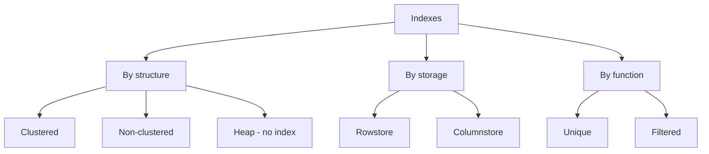
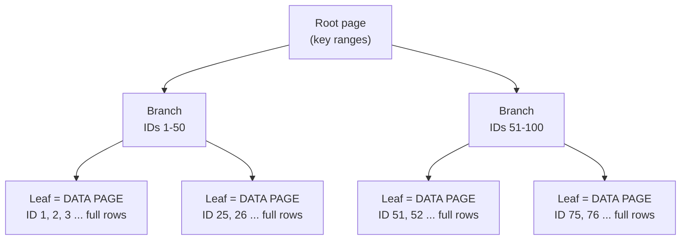
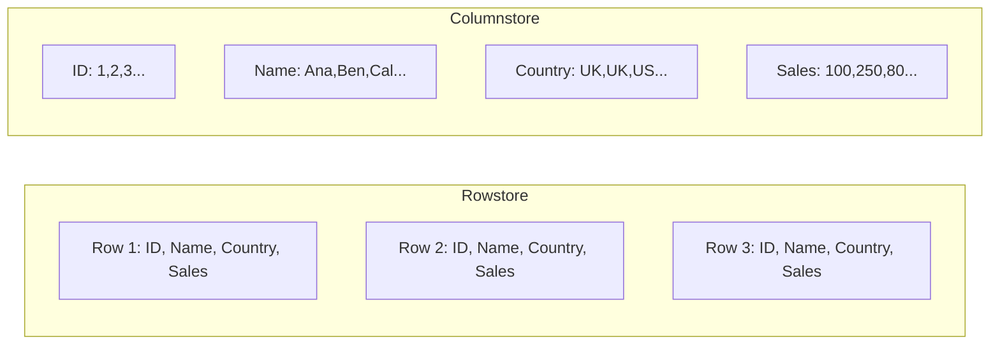
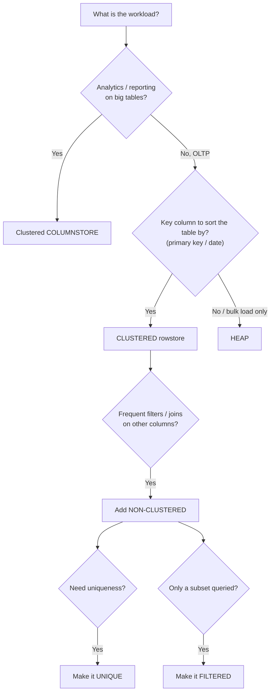

# SQL Indexes (T-SQL / SQL Server)

> Quick reference for index types, how they are stored, when to use each, and how to compare their storage usage.
> Examples use the `Sales.*` practice schema and `AdventureWorks`.

---

## Table of Contents

1. [What is an index?](#1-what-is-an-index)
2. [The index family tree](#2-the-index-family-tree)
3. [Heap (no clustered index)](#3-heap-no-clustered-index)
4. [Clustered index](#4-clustered-index)
5. [Non-clustered index](#5-non-clustered-index)
6. [Rowstore vs Columnstore](#6-rowstore-vs-columnstore)
7. [Unique index](#7-unique-index)
8. [Filtered index](#8-filtered-index)
9. [How to choose the right index](#9-how-to-choose-the-right-index)
10. [Comparing storage: Heap vs Rowstore vs Columnstore](#10-comparing-storage-heap-vs-rowstore-vs-columnstore)
11. [Managing indexes (create / list / disable / drop)](#11-managing-indexes)
12. [Common gotchas](#12-common-gotchas)
13. [Cheat sheet](#13-cheat-sheet)

---

## 1. What is an index?

An index is a **data structure** that gives quick access to data, so queries read less and run faster.

Think of the index at the back of a textbook: instead of reading every page to find "window functions", you look it up and jump straight to the page.

```
 WITHOUT an index                      WITH an index
 ----------------                      -------------
 SELECT ... WHERE CustomerID = 4       SELECT ... WHERE CustomerID = 4

 Scan every row (table scan)           Walk a small tree, jump to the row (seek)

 [1][2][3][4][5][6][7][8] ...          root -> branch -> leaf -> row 4
  ^  ^  ^  ^                            3 page reads, not thousands
  checks every row until done
```

**The trade-off:** indexes make reads faster but writes slower (every INSERT / UPDATE / DELETE must also maintain the index) and they use extra disk space.

---

## 2. The index family tree

Indexes can be classified in three independent ways:



| Classification      | Types                                       | Question it answers                            |
| ------------------- | ------------------------------------------- | ---------------------------------------------- |
| **Structure** | Clustered, Non-clustered (plus Heap = none) | How is the data arranged / located?            |
| **Storage**   | Rowstore, Columnstore                       | Is data stored row by row or column by column? |
| **Function**  | Unique, Filtered                            | What special behaviour does the index add?     |

These combine. For example, you can have a *unique, non-clustered, rowstore* index, or a *filtered non-clustered* index.

---

## 3. Heap (no clustered index)

A **heap** is a table with **no clustered index**. Rows are placed in data pages wherever there is room, in no particular order. When a page is full, SQL Server moves on to the next page.

```
 HEAP (rows in arrival order, no sorting)

 Page 1                 Page 2                 Page 3
 +----------------+     +----------------+     +----------------+
 | ID 7  Maria    |     | ID 2  Ali      |     | ID 9  Sam      |
 | ID 3  John     |     | ID 8  Zoe      |     | ID 1  Kim      |
 | ID 5  Lee      |     | ID 4  Omar     |     | ...            |
 +----------------+     +----------------+     +----------------+

 Finding ID = 4  ->  must scan every page (table scan)
```

Creating a heap from an existing table:

```sql
-- SELECT INTO creates a brand-new table with NO indexes -> a heap
SELECT *
INTO Sales.DBCustomers
FROM Sales.Customers;
```

**Good for:** staging / temp tables where you want to load data as fast as possible and throw it away later.
**Bad for:** anything you query by a key, because every lookup scans the whole table.

---

## 4. Clustered index

A clustered index **sorts and stores the actual table rows** in the order of the index key. The leaf level of the index *is* the data.

- **Only one** clustered index per table (the data can only be physically sorted one way).
- A `PRIMARY KEY` creates a clustered index by default (unless you say otherwise).

```sql
CREATE CLUSTERED INDEX idx_DBCustomers_CustomerID
ON Sales.DBCustomers (CustomerID);
```



```
 CLUSTERED INDEX (B-tree, leaf level = the table itself)

                    [ Root ]
                   /        \
            [ 1 - 50 ]    [ 51 - 100 ]
            /        \      /        \
       [1,2,3..] [25,26..] [51,52..] [75,76..]   <- leaf = actual rows, sorted
```

Finding ID = 76 is now a **seek**: root, branch, leaf. About 3 page reads.

**Good for:** primary keys, date columns, range queries (`BETWEEN`), `ORDER BY` on the key. The typical choice for **OLTP** systems (banking, finance, order entry).

Dropping it turns the table back into a heap:

```sql
DROP INDEX idx_DBCustomers_CustomerID ON Sales.DBCustomers;
```

---

## 5. Non-clustered index

A non-clustered index is a **separate structure** that stores the key column(s) plus a **pointer** back to the row. The table itself is left as it was (heap or clustered).

```sql
CREATE NONCLUSTERED INDEX idx_Orders_CustomerID
ON Sales.Orders (CustomerID);
```


```
 NON-CLUSTERED INDEX                         TABLE
 +--------------+---------+                  +----+----------+---------+-----+
 | CustomerID   | Pointer |                  | ID | Customer | Status  | ... |
 +--------------+---------+                  +----+----------+---------+-----+
 | 1            |  ------>---------------->  | 7  | ...                     |
 | 2            |  ------>                   | 3  | ...                     |
 | 4            |  ------>                   | 5  | ...                     |
 +--------------+---------+                  +----+----------+---------+-----+
   sorted & small                              original, unchanged
```

- You can have **many** (up to 999 in SQL Server).
- If the query needs columns that are not in the index, SQL Server does an extra **key lookup** per row. That is why a non-clustered index helps most when it returns few rows, or when it *covers* the query.

Covering an index with `INCLUDE` (avoids the key lookup):

```sql
CREATE NONCLUSTERED INDEX idx_Orders_CustomerID_cover
ON Sales.Orders (CustomerID)
INCLUDE (OrderDate, Sales);
```

**Good for:** foreign keys, join columns, columns used in `WHERE` filters that are not the primary key.

> Note: `CREATE INDEX` with no keyword gives you a **non-clustered** index. (It is `PRIMARY KEY` that defaults to clustered.)

---

## 6. Rowstore vs Columnstore

This is about **how the data is laid out on disk**.

### Rowstore (the default)

All values of **one row** are stored together. Great for fetching or changing whole rows.

### Columnstore

All values of **one column** are stored together, compressed. Great for scanning and aggregating a few columns across millions of rows.

```
 Logical table                  ROWSTORE layout                COLUMNSTORE layout
 -------------                  ---------------                ------------------
 ID | Name | Country | Sales    Page 1:                        Segment ID:      1 2 3 4 5
 1  | Ana  | UK      | 100        [1, Ana, UK, 100]            Segment Name:    Ana Ben Cal Dee Eli
 2  | Ben  | UK      | 250        [2, Ben, UK, 250]            Segment Country: UK UK US UK US   <- repeats compress well
 3  | Cal  | US      | 80       Page 2:                        Segment Sales:   100 250 80 300 90
 4  | Dee  | UK      | 300        [3, Cal, US, 80]
 5  | Eli  | US      | 90         [4, Dee, UK, 300] ...
```



Query `SELECT SUM(Sales) FROM ...`:

- **Rowstore** reads every page, including Name, Country and so on, even though you only need Sales.
- **Columnstore** reads **only the Sales segment**, and it is compressed, so far fewer bytes are read.

|              | Rowstore                                | Columnstore                                                |
| ------------ | --------------------------------------- | ---------------------------------------------------------- |
| Layout       | Row by row                              | Column by column                                           |
| Compression  | Modest                                  | Very high (similar values sit together)                    |
| Best at      | Point lookups, single-row INSERT/UPDATE | Large scans, aggregations (`SUM`, `AVG`, `GROUP BY`) |
| Workload     | **OLTP** (finance, banking, apps) | **OLAP** (data warehouse, BI, reporting)             |
| Typical size | Larger                                  | Much smaller on big tables                                 |

```sql
-- Convert a table to columnstore storage
CREATE CLUSTERED COLUMNSTORE INDEX idx_person_country_CS
ON person_country_CS;
```

Things to know about columnstore:

- Data is stored in **rowgroups** of up to about 1,048,576 rows. New rows first land in a **delta store** (a small rowstore) until enough accumulate to be compressed. Tiny tables never really benefit.
- A **clustered columnstore** is the table. You can't also have a clustered rowstore index on that table. You can add non-clustered rowstore indexes on top.
- Frequent single-row updates are slow, because an update is internally a delete plus an insert.

---

## 7. Unique index

Guarantees **no duplicate values** in the indexed column(s). The database rejects any INSERT/UPDATE that would create a duplicate.

```sql
SELECT * FROM Sales.Products;

CREATE UNIQUE NONCLUSTERED INDEX idx_product_product
ON Sales.Products (Product);

-- If 'Caps' already exists, this fails (error 2601 - duplicate key):
INSERT INTO Sales.Products (ProductID, Product) VALUES (106, 'Caps');
```

- Writes are slightly slower (a uniqueness check on every insert); reads that filter on the column are fast.
- Primary keys and `UNIQUE` constraints create unique indexes automatically.
- `NULL` counts as a value: a unique index allows only **one** `NULL` in SQL Server.
- Create it **before** loading data, or clean duplicates first, otherwise creation fails.

---

## 8. Filtered index

An index that includes **only the rows that match a condition**. Smaller index means less storage, less maintenance and faster seeks for that subset.

```sql
CREATE NONCLUSTERED INDEX idx_orders_orderstatus
ON Sales.Orders (OrderID)
WHERE OrderStatus = 'Delivered';
```

```
 Full table (all orders)                 Filtered index (Delivered only)
 +---------+-----------+                 +---------+
 | OrderID | Status    |                 | OrderID |
 +---------+-----------+                 +---------+
 | 1       | Delivered |  ---- in ---->  | 1       |
 | 2       | Shipped   |  (skipped)      | 3       |
 | 3       | Delivered |  ---- in ---->  | 5       |
 | 4       | Shipped   |  (skipped)      +---------+
 | 5       | Delivered |  ---- in ---->     3 rows, not 5
 +---------+-----------+
```

```sql
SELECT * FROM Sales.Orders WHERE OrderStatus = 'Shipped';    -- cannot use the index
SELECT * FROM Sales.Orders WHERE OrderStatus = 'Delivered';  -- can use it (see note below)
```

> **Careful with the "faster / slower" claim.** The `Shipped` query is not made *slower* by the index; it just gets no benefit, because shipped rows aren't in it. And the `Delivered` query only benefits if the optimizer picks the index. With `SELECT *` it often won't, because it'd need a key lookup for every column. Check the **execution plan** (`Ctrl+M` in SSMS, or `SET STATISTICS IO ON`) to see what really happened.

**Good for:** a small, frequently queried slice of a big table, such as "active" rows, "open" orders, or non-NULL values.

---

## 9. How to choose the right index



| Index                           | Use it when                                        | Typical use                                                  |
| ------------------------------- | -------------------------------------------------- | ------------------------------------------------------------ |
| **Heap**                  | Fast bulk inserts; table is temporary              | Staging / temp tables, loaded then discarded                 |
| **Clustered (rowstore)**  | Default choice for a table with a key              | Primary keys, date columns;**OLTP** (finance, banking) |
| **Clustered columnstore** | Big tables, scans and aggregates; want compression | **OLAP** (data warehouse, BI, reporting)               |
| **Non-clustered**         | Non-PK columns used in filters and joins           | Foreign keys, join and`WHERE` columns                      |
| **Filtered**              | Queries target a small subset                      | "Open" / "active" rows; smaller index                        |
| **Unique**                | Must enforce no duplicates                         | Emails, product codes, business keys                         |

Rules of thumb:

1. Start with a clustered index on the primary key (or date for time-series tables).
2. Add non-clustered indexes only for queries you actually run. Every extra index slows writes.
3. Index columns used in `JOIN`, `WHERE`, `ORDER BY`, `GROUP BY`.
4. Don't index tiny tables, or columns with very few distinct values (like a yes/no flag), unless filtered.
5. Measure with the execution plan before and after.

---

## 10. Comparing storage: Heap vs Rowstore vs Columnstore

Same data, stored three ways in `AdventureWorks`:

```sql
USE AdventureWorks2025;

-- 1) HEAP (no index)
SELECT *
INTO person_country_HP
FROM Person.CountryRegion;

-- 2) ROWSTORE (clustered B-tree index)
SELECT *
INTO person_country_RS
FROM Person.CountryRegion;

CREATE CLUSTERED INDEX idx_person_country_RS_PK
ON person_country_RS (CountryRegionCode);

-- 3) COLUMNSTORE (clustered columnstore index)
SELECT *
INTO person_country_CS
FROM Person.CountryRegion;

CREATE CLUSTERED COLUMNSTORE INDEX idx_person_country_CS
ON person_country_CS;
```

### Measure the size of each

```sql
EXEC sp_spaceused 'person_country_HP';
EXEC sp_spaceused 'person_country_RS';
EXEC sp_spaceused 'person_country_CS';
```

Or all three in one result:

```sql
SELECT
    t.name AS TableName,
    i.type_desc AS IndexType,
    SUM(p.rows) AS RowCounts,
    CAST(SUM(a.total_pages) * 8 / 1024.0 AS DECIMAL(10,3)) AS TotalMB
FROM sys.tables t
JOIN sys.indexes i          ON i.object_id = t.object_id
JOIN sys.partitions p       ON p.object_id = i.object_id AND p.index_id = i.index_id
JOIN sys.allocation_units a ON a.container_id = p.partition_id
WHERE t.name IN ('person_country_HP', 'person_country_RS', 'person_country_CS')
GROUP BY t.name, i.type_desc
ORDER BY TotalMB;
```

### What to expect

| Table                 | `type_desc`             | Expectation                                                                |
| --------------------- | ------------------------- | -------------------------------------------------------------------------- |
| `person_country_HP` | `HEAP`                  | Raw data pages only.                                                       |
| `person_country_RS` | `CLUSTERED`             | About the heap size, plus a little for the B-tree's root and branch pages. |
| `person_country_CS` | `CLUSTERED COLUMNSTORE` | **Not necessarily smaller here.**                                    |

`Person.CountryRegion` has only a couple of hundred rows. Columnstore compression pays off on **hundreds of thousands to millions** of rows, and a tiny table sits in the uncompressed delta store with extra metadata overhead. So on this table, columnstore may show the same size or even a bit larger. To see the real effect, repeat the test on a big table (for example `Sales.SalesOrderDetail` or `Sales.SalesOrderHeader` in AdventureWorks) and compare sizes.

```
 Illustrative shape of the result on a LARGE table (not real numbers):

 Heap         ########################  100%
 Rowstore     #########################  ~105%   (B-tree overhead)
 Columnstore  #####                      ~20-30%  (compression)
```

### Clean up when done

```sql
DROP TABLE person_country_HP, person_country_RS, person_country_CS;
```

---

## 11. Managing indexes

```sql
-- List indexes on a table
EXEC sp_helpindex 'Sales.Orders';

SELECT name, type_desc, is_unique, is_primary_key, has_filter, filter_definition
FROM sys.indexes
WHERE object_id = OBJECT_ID('Sales.Orders')
  AND name IS NOT NULL;               -- NULL name = heap

-- Drop (SQL Server needs ON <table>)
DROP INDEX idx_orders_orderstatus ON Sales.Orders;
DROP INDEX IF EXISTS idx_orders_orderstatus ON Sales.Orders;   -- 2016+

-- Disable without losing the definition, then bring back
ALTER INDEX idx_orders_orderstatus ON Sales.Orders DISABLE;
ALTER INDEX idx_orders_orderstatus ON Sales.Orders REBUILD;

-- Maintenance
ALTER INDEX ALL ON Sales.Orders REORGANIZE;  -- light, online
ALTER INDEX ALL ON Sales.Orders REBUILD;     -- heavy, rebuilds from scratch

-- Indexes created by PK / UNIQUE constraints: drop the constraint instead
ALTER TABLE Sales.Orders DROP CONSTRAINT PK_Orders;
```

Dropping a **clustered** index turns the table back into a heap (data is kept). Dropping a **non-clustered** index never loses data.

---

## 12. Common gotchas

1. **Indexes slow writes.** Every INSERT/UPDATE/DELETE maintains every index on the table. Don't index "just in case".
2. **Functions on the column kill index use.** `WHERE YEAR(OrderDate) = 2025` can't seek; use `WHERE OrderDate >= '2025-01-01' AND OrderDate < '2026-01-01'`.
3. **Leading wildcard.** `LIKE '%son'` can't seek; `LIKE 'John%'` can.
4. **Implicit conversion.** Comparing a `VARCHAR` column to an `NVARCHAR` value can turn a seek into a scan.
5. **`SELECT *` defeats covering indexes.** Select only the columns you need.
6. **Only one clustered index** per table (rowstore *or* clustered columnstore).
7. **Creating a clustered index on a heap** rewrites the whole table, which can be slow on large tables.
8. **Columnstore on small tables** doesn't help (see section 10).
9. **Filtered index and parameters.** The query's `WHERE` must match the index filter for the optimizer to use it; with parameters it often can't.
10. **Unique index with existing duplicates** fails to create. Find them first:
    ```sql
    SELECT Product, COUNT(*) FROM Sales.Products GROUP BY Product HAVING COUNT(*) > 1;
    ```
11. **Heap and reads.** A heap is fast for loading data, but not for reading it by key.

---

## 13. Cheat sheet

| I want to...                              | Do this                                         |
| ----------------------------------------- | ----------------------------------------------- |
| Load data fast, throw away later          | **Heap**                                  |
| Sort the table by its key                 | `CREATE CLUSTERED INDEX ... ON t (key)`       |
| Speed up joins / filters on other columns | `CREATE NONCLUSTERED INDEX ... ON t (col)`    |
| Avoid key lookups                         | `... INCLUDE (colA, colB)`                    |
| Fast analytics, smaller storage           | `CREATE CLUSTERED COLUMNSTORE INDEX ... ON t` |
| Block duplicate values                    | `CREATE UNIQUE NONCLUSTERED INDEX ...`        |
| Index only part of the data               | `... WHERE condition` (filtered)              |
| See indexes on a table                    | `EXEC sp_helpindex 'schema.table'`            |
| See table size                            | `EXEC sp_spaceused 'schema.table'`            |
| Remove an index                           | `DROP INDEX name ON schema.table`             |
| Pause an index                            | `ALTER INDEX name ON t DISABLE`               |

```
 Mental model

 OLTP  (many small reads/writes)   ->  Clustered rowstore + a few non-clustered
 OLAP  (few huge scans)            ->  Clustered columnstore
 Staging / temp                    ->  Heap
```
