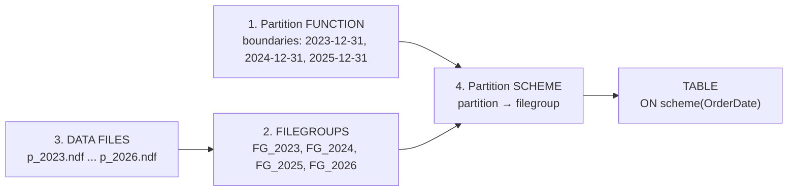
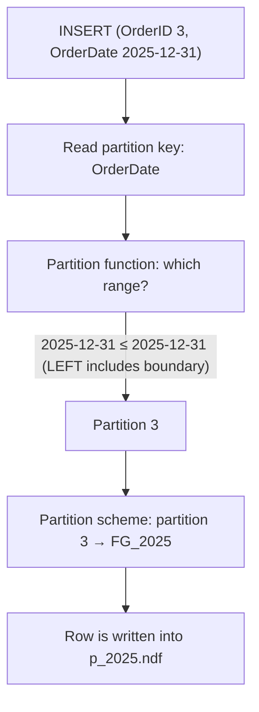
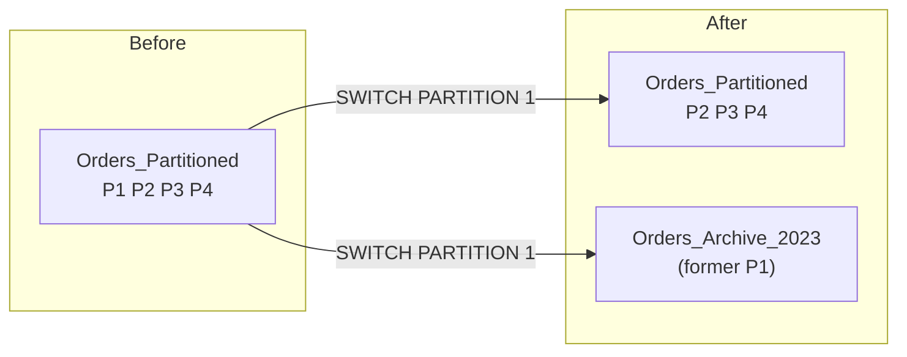

# SQL Table Partitioning (T-SQL / SQL Server)

> Split one big table into smaller physical pieces (partitions) while it still looks like a single table to queries.
> Example: `Sales.Orders_Partitioned` partitioned by year on `SalesDB`.

---

## Table of Contents

1. [What is partitioning and why use it?](#1-what-is-partitioning-and-why-use-it)
2. [The four building blocks](#2-the-four-building-blocks)
3. [Big picture](#3-big-picture)
4. [RANGE LEFT vs RANGE RIGHT](#4-range-left-vs-range-right)
5. [Step-by-step build](#5-step-by-step-build)
6. [Where did my rows go?](#6-where-did-my-rows-go)
7. [Partition elimination (the performance win)](#7-partition-elimination-the-performance-win)
8. [Maintenance: SPLIT, MERGE, SWITCH](#8-maintenance-split-merge-switch)
9. [Cleanup](#9-cleanup)
10. [Common gotchas](#10-common-gotchas)
11. [Partitioning vs indexing](#11-partitioning-vs-indexing)
12. [Cheat sheet](#12-cheat-sheet)

---

## 1. What is partitioning and why use it?

Partitioning divides a large table into **partitions** based on the values of one column (the **partition key**), for example `OrderDate`. Each partition can live in its own filegroup and be managed separately.

```
 One logical table: Sales.Orders_Partitioned
 ┌──────────────────────────────────────────────────────────────┐
 │  P1: <= 2023-12-31 │ P2: 2024 │ P3: 2025 │ P4: > 2025-12-31  │
 └────────┬───────────┴────┬─────┴────┬─────┴─────────┬─────────┘
          │                │          │               │
       FG_2023          FG_2024    FG_2025         FG_2026
       (p_2023.ndf)     (p_2024)   (p_2025)        (p_2026)
```

**Benefits**

| Benefit                            | What it means                                                                                |
| ---------------------------------- | -------------------------------------------------------------------------------------------- |
| **Partition elimination**    | A query with `WHERE OrderDate` in 2025 reads only the 2025 partition, not the whole table. |
| **Easier maintenance**       | Rebuild an index or back up one partition or filegroup instead of the whole table.           |
| **Fast archiving / loading** | `SWITCH` a partition in or out in milliseconds (metadata-only operation).                  |
| **Storage tiering**          | Put old, rarely used partitions on cheaper disks.                                            |

**Typical use:** very large tables (tens of millions of rows and up), especially time-series / fact tables in data warehouses. On a small table partitioning adds complexity and gives little benefit.

> Table partitioning is available in **all editions** (including Express, which you're using) since SQL Server 2016 SP1.

---

## 2. The four building blocks

| # | Object                       | What it does                                                                        | Analogy                                              |
| - | ---------------------------- | ----------------------------------------------------------------------------------- | ---------------------------------------------------- |
| 1 | **Partition function** | Defines *how* to cut the data: the boundary values and which side they belong to. | The cutting lines on a map                           |
| 2 | **Filegroup**          | A logical container for one or more data files.                                     | A labelled shelf                                     |
| 3 | **Data file (.ndf)**   | The physical file on disk that holds the data.                                      | The actual shelf board                               |
| 4 | **Partition scheme**   | Maps each partition (from the function) to a filegroup.                             | The shelf label list: "section 1 goes on shelf A..." |

Then the **table** is created `ON` the scheme and told which column is the partition key.



Build order (you can't reference something that doesn't exist yet):

```
 function  →  filegroups  →  data files  →  scheme  →  table
   (1)           (2)            (3)          (4)        (5)
```

*Files:* `.mdf` is the primary data file, `.ndf` are secondary data files, `.ldf` is the transaction log.

---

## 3. Big picture

How a row finds its home when you `INSERT`:



---

## 4. RANGE LEFT vs RANGE RIGHT

The boundary value itself must belong to *one* side:

- `RANGE LEFT`: the boundary value belongs to the partition on its **left** (it is the *last* value of that partition).
- `RANGE RIGHT`: the boundary value belongs to the partition on its **right** (it is the *first* value of that partition).

Your function: `RANGE LEFT FOR VALUES ('2023-12-31', '2024-12-31', '2025-12-31')`

```
        P1                 P2                    P3                    P4
 ◄────────────────┤ ◄────────────────────┤ ◄────────────────────┤ ───────────────►
   ≤ 2023-12-31       2024-01-01 ..          2025-01-01 ..          > 2025-12-31
                      2024-12-31             2025-12-31
              ▲                      ▲                      ▲
        boundary 1             boundary 2             boundary 3
        (stays LEFT)           (stays LEFT)           (stays LEFT)
```

**N boundary values always create N + 1 partitions.** 3 boundaries → 4 partitions → you need 4 filegroups in the scheme (FG_2023, FG_2024, FG_2025, FG_2026). The last one, FG_2026, is the "everything after 2025" partition.

|                                       | LEFT                          | RIGHT                         |
| ------------------------------------- | ----------------------------- | ----------------------------- |
| Boundary `2024-12-31`               | Belongs to the 2024 partition | Belongs to the next partition |
| Natural boundary values               | Last day: `'2024-12-31'`    | First day: `'2025-01-01'`   |
| Safe for `DATE`                     | Yes                           | Yes                           |
| Safe for `DATETIME` / `DATETIME2` | **No** (see gotcha 4)   | **Yes**, preferred      |

**Recommendation:** use `RANGE RIGHT` with *first-day* boundaries (`'2024-01-01'`, `'2025-01-01'`, ...) for date keys. It works for every date type. Your `DATE` + `LEFT` version is fine for this exercise.

---

## 5. Step-by-step build

> Run everything with the right database selected: add `USE SalesDB;` at the top. See gotcha 1.

### Step 1: Partition function

```sql
USE SalesDB;
GO

CREATE PARTITION FUNCTION PartitionByYear (DATE)
AS RANGE LEFT FOR VALUES ('2023-12-31', '2024-12-31', '2025-12-31');
```

List existing partition functions:

```sql
SELECT name, function_id, type, type_desc, boundary_value_on_right
FROM sys.partition_functions;
```

`boundary_value_on_right = 0` means LEFT, `1` means RIGHT.

See the boundary values themselves:

```sql
SELECT pf.name, prv.boundary_id, prv.value
FROM sys.partition_functions pf
JOIN sys.partition_range_values prv ON prv.function_id = pf.function_id
WHERE pf.name = 'PartitionByYear'
ORDER BY prv.boundary_id;
```

### Step 2: Filegroups

```sql
ALTER DATABASE SalesDB ADD FILEGROUP FG_2023;
ALTER DATABASE SalesDB ADD FILEGROUP FG_2024;
ALTER DATABASE SalesDB ADD FILEGROUP FG_2025;
ALTER DATABASE SalesDB ADD FILEGROUP FG_2026;
```

List them:

```sql
SELECT * FROM sys.filegroups WHERE type = 'FG';
```

### Step 3: Data files (.ndf), one per filegroup

```sql
ALTER DATABASE SalesDB ADD FILE
(
    NAME     = p_2023,   -- logical name (must be unique in the database)
    FILENAME = 'C:\Program Files\Microsoft SQL Server\MSSQL17.SQLEXPRESS\MSSQL\DATA\p_2023.ndf'
) TO FILEGROUP FG_2023;

ALTER DATABASE SalesDB ADD FILE
(
    NAME     = p_2024,
    FILENAME = 'C:\Program Files\Microsoft SQL Server\MSSQL17.SQLEXPRESS\MSSQL\DATA\p_2024.ndf'
) TO FILEGROUP FG_2024;

ALTER DATABASE SalesDB ADD FILE
(
    NAME     = p_2025,
    FILENAME = 'C:\Program Files\Microsoft SQL Server\MSSQL17.SQLEXPRESS\MSSQL\DATA\p_2025.ndf'
) TO FILEGROUP FG_2025;

ALTER DATABASE SalesDB ADD FILE
(
    NAME     = p_2026,
    FILENAME = 'C:\Program Files\Microsoft SQL Server\MSSQL17.SQLEXPRESS\MSSQL\DATA\p_2026.ndf'
) TO FILEGROUP FG_2026;
```

Optional: set size and growth so the files don't grow in tiny steps:

```sql
-- add to each ADD FILE definition:
--   SIZE = 50MB, FILEGROWTH = 50MB
```

Check filegroups and their files:

```sql
SELECT
    fg.name          AS FilegroupName,
    mf.name          AS LogicalFileName,
    mf.physical_name AS PhysicalFilePath,
    mf.size / 128    AS SizeInMB          -- size is in 8 KB pages; 128 pages = 1 MB
FROM sys.filegroups fg
JOIN sys.master_files mf ON fg.data_space_id = mf.data_space_id
WHERE mf.database_id = DB_ID('SalesDB');
```

### Step 4: Partition scheme

```sql
CREATE PARTITION SCHEME SchemePartitionByYear
AS PARTITION PartitionByYear
TO (FG_2023, FG_2024, FG_2025, FG_2026);
```

The filegroups are listed **in partition order**: first → partition 1, second → partition 2, and so on.

List the scheme and its mapping:

```sql
SELECT
    ps.name AS PartitionSchemeName,
    pf.name AS PartitionFunctionName,
    ds.destination_id AS PartitionNumber,
    fg.name AS FileGroupName
FROM sys.partition_schemes AS ps
JOIN sys.partition_functions AS pf        ON ps.function_id = pf.function_id
JOIN sys.destination_data_spaces AS ds    ON ps.data_space_id = ds.partition_scheme_id
JOIN sys.filegroups AS fg                 ON ds.data_space_id = fg.data_space_id
ORDER BY ds.destination_id;
```

Expected:

| PartitionSchemeName   | PartitionFunctionName | PartitionNumber | FileGroupName |
| --------------------- | --------------------- | --------------- | ------------- |
| SchemePartitionByYear | PartitionByYear       | 1               | FG_2023       |
| SchemePartitionByYear | PartitionByYear       | 2               | FG_2024       |
| SchemePartitionByYear | PartitionByYear       | 3               | FG_2025       |
| SchemePartitionByYear | PartitionByYear       | 4               | FG_2026       |

### Step 5: Partitioned table

```sql
CREATE TABLE Sales.Orders_Partitioned
(
    OrderID   INT,
    OrderDate DATE,
    Sales     INT
)
ON SchemePartitionByYear (OrderDate);   -- scheme + partition key column
```

The partition key's data type must match the function's type (`DATE` here).

> The table has no index, so this is a **partitioned heap**. In real use you normally add a clustered index on the same scheme: see [section 11](#11-partitioning-vs-indexing).

### Step 6: Insert data

```sql
INSERT INTO Sales.Orders_Partitioned VALUES (1, '2023-05-15', 100);
INSERT INTO Sales.Orders_Partitioned VALUES (2, '2024-05-15', 150);
INSERT INTO Sales.Orders_Partitioned VALUES (3, '2025-12-31', 990);
INSERT INTO Sales.Orders_Partitioned VALUES (4, '2026-05-15', 230);

SELECT * FROM Sales.Orders_Partitioned;
```

---

## 6. Where did my rows go?

### Quickest way: `$PARTITION`

```sql
SELECT
    OrderID,
    OrderDate,
    $PARTITION.PartitionByYear(OrderDate) AS PartitionNumber
FROM Sales.Orders_Partitioned;
```

Expected result, worked out from the LEFT boundaries (the boundary date itself stays in the lower partition):

| OrderID | OrderDate  | PartitionNumber | Filegroup | Why                                                             |
| ------- | ---------- | --------------- | --------- | --------------------------------------------------------------- |
| 1       | 2023-05-15 | 1               | FG_2023   | ≤ 2023-12-31                                                   |
| 2       | 2024-05-15 | 2               | FG_2024   | between 2023-12-31 and 2024-12-31                               |
| 3       | 2025-12-31 | 3               | FG_2025   | **equals** the 3rd boundary; LEFT keeps it in partition 3 |
| 4       | 2026-05-15 | 4               | FG_2026   | > 2025-12-31                                                    |

Row 3 (`2025-12-31`) is the interesting one. With `RANGE RIGHT` it would have moved to the next partition.

### Rows per partition (your query)

```sql
SELECT
    p.partition_number AS PartitionNumber,
    f.name             AS PartitionFileGroup,
    p.rows             AS NumberOfRows
FROM sys.partitions AS p
JOIN sys.destination_data_spaces dds ON p.partition_number = dds.destination_id
JOIN sys.filegroups AS f             ON dds.data_space_id = f.data_space_id
WHERE OBJECT_NAME(p.object_id) = 'Orders_Partitioned';
```

It works while the database has one partition scheme. With a second scheme it would return duplicate rows, because the join doesn't say *which* scheme the table uses. A more robust version:

```sql
SELECT
    p.partition_number AS PartitionNumber,
    f.name             AS PartitionFileGroup,
    p.rows             AS NumberOfRows
FROM sys.partitions AS p
JOIN sys.indexes AS i                ON i.object_id = p.object_id
                                    AND i.index_id  = p.index_id
JOIN sys.destination_data_spaces dds ON dds.partition_scheme_id = i.data_space_id
                                    AND dds.destination_id      = p.partition_number
JOIN sys.filegroups AS f             ON f.data_space_id = dds.data_space_id
WHERE p.object_id = OBJECT_ID('Sales.Orders_Partitioned')
ORDER BY p.partition_number;
```

Expected: 4 rows, one per partition, each with `NumberOfRows = 1` (FG_2023, FG_2024, FG_2025, FG_2026).

---

## 7. Partition elimination (the performance win)

Filter on the partition key and SQL Server skips partitions that can't match:

```sql
SET STATISTICS IO ON;

SELECT * FROM Sales.Orders_Partitioned
WHERE OrderDate BETWEEN '2025-01-01' AND '2025-12-31';   -- touches partition 3 only
```

In the execution plan, look at the table scan/seek **Properties → Actual Partition Count** (should be `1`, not `4`). On a tiny demo table you won't feel a speed difference. It matters at millions of rows.

Elimination only works when the `WHERE` uses the partition key **directly**:

```sql
WHERE OrderDate >= '2025-01-01' AND OrderDate < '2026-01-01'   -- eliminates
WHERE YEAR(OrderDate) = 2025                                   -- may scan all partitions
```

---

## 8. Maintenance: SPLIT, MERGE, SWITCH

### SPLIT: add a new partition (e.g. for 2027)

The last partition is open-ended, so new years pile into FG_2026. To carve out 2026 on its own:

```sql
-- 1) New filegroup + file for the new range
ALTER DATABASE SalesDB ADD FILEGROUP FG_2027;
ALTER DATABASE SalesDB ADD FILE
(
    NAME = p_2027,
    FILENAME = 'C:\Program Files\Microsoft SQL Server\MSSQL17.SQLEXPRESS\MSSQL\DATA\p_2027.ndf'
) TO FILEGROUP FG_2027;

-- 2) Tell the scheme where the next new partition goes
ALTER PARTITION SCHEME SchemePartitionByYear NEXT USED FG_2027;

-- 3) Add the boundary
ALTER PARTITION FUNCTION PartitionByYear() SPLIT RANGE ('2026-12-31');
```

Result: partition 4 = 2026 (FG_2026), partition 5 = after 2026 (FG_2027).
Splitting a partition that already holds data forces SQL Server to move rows, which can be slow. Split **empty** ranges ahead of time.

### MERGE: remove a boundary

```sql
ALTER PARTITION FUNCTION PartitionByYear() MERGE RANGE ('2023-12-31');
```

Combines partition 1 and 2 into one.

### SWITCH: move a whole partition in or out instantly

```sql
-- Archive 2023: needs an empty table with the identical structure on the same filegroup
ALTER TABLE Sales.Orders_Partitioned
SWITCH PARTITION 1 TO Sales.Orders_Archive_2023;
```

It's a metadata-only change, so millions of rows move in about a millisecond. The target table must match the source's columns, data types, nullability, indexes and filegroup, and be empty.



---

## 9. Cleanup

Reverse order of creation. The filegroups must be empty and their files removed first:

```sql
DROP TABLE Sales.Orders_Partitioned;
DROP PARTITION SCHEME SchemePartitionByYear;
DROP PARTITION FUNCTION PartitionByYear;

ALTER DATABASE SalesDB REMOVE FILE p_2023;
ALTER DATABASE SalesDB REMOVE FILE p_2024;
ALTER DATABASE SalesDB REMOVE FILE p_2025;
ALTER DATABASE SalesDB REMOVE FILE p_2026;

ALTER DATABASE SalesDB REMOVE FILEGROUP FG_2023;
ALTER DATABASE SalesDB REMOVE FILEGROUP FG_2024;
ALTER DATABASE SalesDB REMOVE FILEGROUP FG_2025;
ALTER DATABASE SalesDB REMOVE FILEGROUP FG_2026;
```

---

## 10. Common gotchas

1. **Run it in the right database.** `CREATE PARTITION FUNCTION` and `CREATE PARTITION SCHEME` create objects in the *current* database, and `sys.filegroups` / `sys.partition_*` only show the current database. `ALTER DATABASE SalesDB` works from anywhere, so a missing `USE SalesDB;` is easy to miss. Put `USE SalesDB; GO` at the top.
2. **N boundaries = N + 1 partitions.** The scheme needs N + 1 filegroups (or use `ALL TO ([PRIMARY])` to put everything on one).
3. **Scheme order matters.** Filegroups map to partitions by position in the `TO (...)` list.
4. **LEFT + `DATETIME` is a trap.** A `DATETIME` value of `'2023-12-31 10:30'` is *greater than* `'2023-12-31'`, so it lands in the **next** partition, not 2023. Use `RANGE RIGHT` with first-of-period boundaries (`'2024-01-01'`) for any type with a time part.
5. **The partition key column must match the function type** (`DATE` ↔ `DATE`), and be a single column (computed columns need to be persisted).
6. **Unique / primary key indexes must include the partition key.** A `PRIMARY KEY (OrderID)` on a table partitioned by `OrderDate` fails; use `(OrderID, OrderDate)`, or make the index non-unique.
7. **Wrap `ADD FILE` paths carefully.** The folder must exist and the SQL Server service account needs write permission. The default `...\MSSQL\DATA\` folder already has it. A custom folder may fail with an operating-system error 5 (access denied).
8. **Logical file names must be unique** in the database (`p_2023` can't be reused).
9. **Partitioning is not automatic indexing.** It does not make queries faster by itself; only queries that filter on the partition key benefit.
10. **Splitting a populated partition is expensive.** Create future partitions in advance while they're empty.
11. **More partitions are not always better.** Thousands of tiny partitions hurt plan compilation and maintenance. The hard limit is 15,000 per table.
12. **Dropping order matters.** Table → scheme → function → files → filegroups.

---

## 11. Partitioning vs indexing

They solve different problems and work together.

|             | Index                          | Partitioning                                   |
| ----------- | ------------------------------ | ---------------------------------------------- |
| Goal        | Find rows quickly              | Split big data into manageable chunks          |
| Mechanism   | B-tree / columnstore structure | Physical division by a key                     |
| Helps       | Selective lookups              | Range scans on the key, maintenance, archiving |
| Needed when | Almost always                  | Very large tables (millions+ rows)             |

On a partitioned table you normally create the clustered index **on the partition scheme** so the index is *aligned* with the data:

```sql
CREATE CLUSTERED INDEX idx_Orders_Partitioned_OrderDate
ON Sales.Orders_Partitioned (OrderDate)
ON SchemePartitionByYear (OrderDate);
```

A clustered columnstore index also works well with partitioning. It's the classic data-warehouse pattern: partition by date plus columnstore for compression and fast scans.

---

## 12. Cheat sheet

| Step | Object             | Command                                                                        |
| ---- | ------------------ | ------------------------------------------------------------------------------ |
| 1    | Partition function | `CREATE PARTITION FUNCTION name (type) AS RANGE LEFT\|RIGHT FOR VALUES (...)` |
| 2    | Filegroup          | `ALTER DATABASE db ADD FILEGROUP fg`                                         |
| 3    | Data file          | `ALTER DATABASE db ADD FILE (NAME=..., FILENAME=...) TO FILEGROUP fg`        |
| 4    | Partition scheme   | `CREATE PARTITION SCHEME name AS PARTITION func TO (fg1, fg2, ...)`          |
| 5    | Table              | `CREATE TABLE t (...) ON scheme (key_column)`                                |

| I want to...                          | Use                                                                                               |
| ------------------------------------- | ------------------------------------------------------------------------------------------------- |
| See which partition a value goes to   | `$PARTITION.func(value)`                                                                        |
| See rows per partition                | `sys.partitions` (joined as in section 6)                                                       |
| Add a new range                       | `ALTER PARTITION SCHEME ... NEXT USED fg` then `ALTER PARTITION FUNCTION ... SPLIT RANGE (v)` |
| Remove a range                        | `ALTER PARTITION FUNCTION ... MERGE RANGE (v)`                                                  |
| Archive/load instantly                | `ALTER TABLE ... SWITCH PARTITION n TO other_table`                                             |
| List functions / schemes / filegroups | `sys.partition_functions` / `sys.partition_schemes` / `sys.filegroups`                      |

```
 Mental model

 FUNCTION  = where the cut lines are          (N boundaries -> N+1 partitions)
 SCHEME    = which filegroup each piece uses
 FILEGROUP = the folder; DATA FILE = the actual .ndf on disk
 TABLE     = created ON the scheme, partitioned by one key column
```
