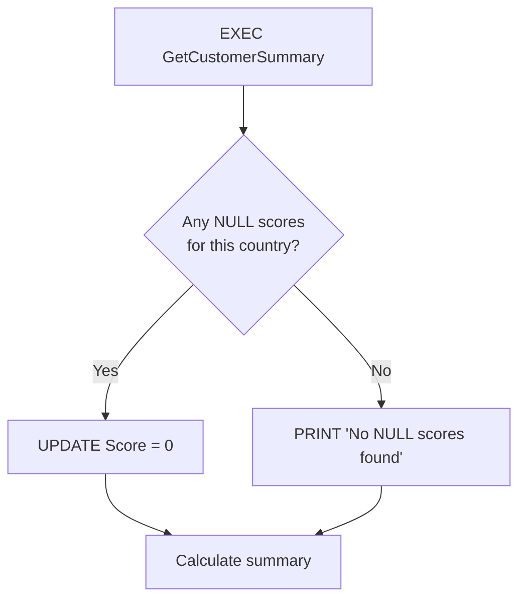
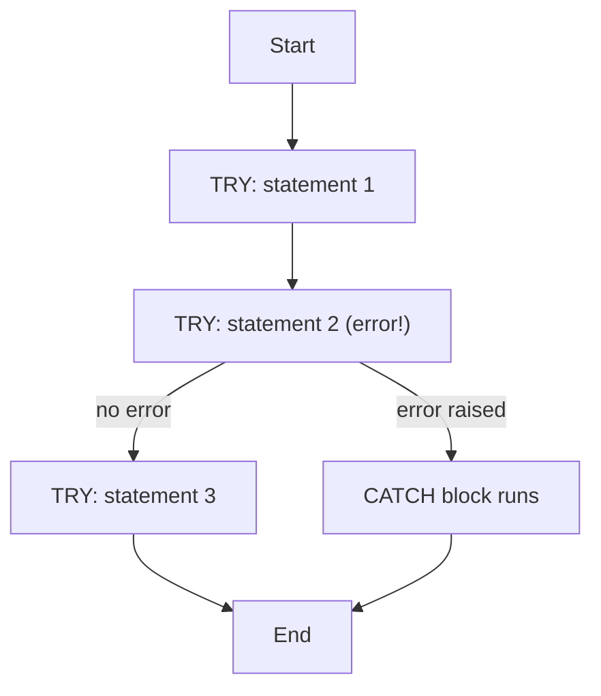

# SQL Stored Procedures (T-SQL / SQL Server)

> A stored procedure is a saved, named block of SQL that you run with `EXEC`. It can take parameters, run many statements, make decisions, handle errors and return results.

---

## Table of Contents

1. [What is a stored procedure?](#1-what-is-a-stored-procedure)
2. [Basic syntax](#2-basic-syntax)
3. [From query to procedure (step by step)](#3-from-query-to-procedure-step-by-step)
4. [Parameters](#4-parameters)
5. [Variables, PRINT and result sets](#5-variables-print-and-result-sets)
6. [Control flow: IF / ELSE](#6-control-flow-if--else)
7. [Error handling: TRY...CATCH](#7-error-handling-trycatch)
8. [Full example: customer summary report](#8-full-example-customer-summary-report)
9. [Managing procedures: alter, drop, inspect](#9-managing-procedures-alter-drop-inspect)
10. [Transactions inside procedures](#10-transactions-inside-procedures)
11. [Stored procedure vs view vs function](#11-stored-procedure-vs-view-vs-function)
12. [Why use them (and when not to)](#12-why-use-them-and-when-not-to)
13. [Common gotchas](#13-common-gotchas)
14. [Cheat sheet](#14-cheat-sheet)

---

## 1. What is a stored procedure?

You write SQL once, give it a name, store it **in the database**, and call it by name whenever you need it.

```
 Without a procedure                    With a procedure
 -------------------                    ----------------
 App / user pastes the same             App / user:  EXEC GetCustomerSummary @Country = 'Germany'
 5 queries every time                           │
                                                ▼
                                        ┌──────────────────────────────┐
                                        │ GetCustomerSummary (stored)  │
                                        │  1. clean data               │
                                        │  2. count customers / score  │
                                        │  3. total orders / sales     │
                                        └──────────────────────────────┘
```

| Benefit                     | Meaning                                                                           |
| --------------------------- | --------------------------------------------------------------------------------- |
| **Reuse**             | Write once, call from anywhere (reports, apps, jobs)                              |
| **One place to fix**  | Change the logic in the procedure, every caller gets it                           |
| **Fewer round trips** | One call runs many statements on the server                                       |
| **Security**          | Grant `EXECUTE` on the procedure without giving access to the underlying tables |
| **Safer input**       | Parameters are not pasted into the SQL text, which blocks SQL injection           |
| **Plan reuse**        | SQL Server caches the execution plan                                              |

---

## 2. Basic syntax

```sql
CREATE PROCEDURE ProcedureName
AS
BEGIN
    -- SQL statements go here
END
```

Run it:

```sql
EXEC ProcedureName;
```

Notes:

- `CREATE PROCEDURE` must be the **first statement in its batch**. Separate it from other code with `GO`.
- `PROC` is accepted as short for `PROCEDURE`.
- Prefer a schema-qualified name (`dbo.GetCustomerSummary` or `Sales.GetCustomerSummary`) so there's no doubt where it lives.
- Don't name your procedures `sp_something`. SQL Server looks in `master` first for names starting with `sp_`, which is slower and can pick up the wrong object.

---

## 3. From query to procedure (step by step)

### Step 1: Write and test the plain query

```sql
-- For US customers: total customers and average score
SELECT
    COUNT(*)   AS total_customer,
    AVG(Score) AS avg_score
FROM Sales.Customers
WHERE Country = 'USA';
```

### Step 2: Wrap it in a procedure, replacing the hard-coded value with a parameter

```sql
CREATE PROCEDURE GetCustomerSummary @Country NVARCHAR(50)
AS
BEGIN
    SELECT
        COUNT(*)   AS total_customer,
        AVG(Score) AS avg_score
    FROM Sales.Customers
    WHERE Country = @Country;
END
GO
```

### Step 3: Execute it

```sql
EXEC GetCustomerSummary @Country = 'Germany';
```

> **This one fails in your notes:**
>
> ```sql
> EXEC GetCustomerSummary          -- no parameter given
> ```
>
> With this version, `@Country` has **no default value**, so SQL Server raises *"Procedure or function 'GetCustomerSummary' expects parameter '@Country', which was not supplied."* You need to either pass a value, or give the parameter a default (next section).

---

## 4. Parameters

A parameter is a named input, declared after the procedure name, starting with `@`.

### 4.1 Required parameter

```sql
CREATE PROCEDURE GetCustomerSummary @Country NVARCHAR(50)
```

### 4.2 Parameter with a default value

```sql
ALTER PROCEDURE GetCustomerSummary @Country NVARCHAR(50) = 'USA'   -- 'USA' is the default
AS
BEGIN
    SELECT COUNT(*) AS total_customer, AVG(Score) AS avg_score
    FROM Sales.Customers
    WHERE Country = @Country;
END
```

```sql
EXEC GetCustomerSummary;                       -- uses 'USA'
EXEC GetCustomerSummary @Country = 'Germany';  -- overrides the default
```

### 4.3 Several parameters

```sql
CREATE PROCEDURE GetOrders
    @Country    NVARCHAR(50) = 'USA',
    @FromDate   DATE         = '2025-01-01'
AS
BEGIN
    SELECT o.OrderID, o.OrderDate, o.Sales
    FROM Sales.Orders o
    JOIN Sales.Customers c ON c.CustomerID = o.CustomerID
    WHERE c.Country = @Country
      AND o.OrderDate >= @FromDate;
END
GO

EXEC GetOrders @Country = 'Germany', @FromDate = '2025-06-01';   -- named (clearest)
EXEC GetOrders 'Germany', '2025-06-01';                          -- positional (order matters)
EXEC GetOrders @FromDate = '2025-06-01';                         -- skip the first, default used
```

Named parameters are safer: they keep working if someone adds a parameter later.

### 4.4 Output parameters

Send a value **back** to the caller:

```sql
CREATE PROCEDURE GetCustomerCount
    @Country NVARCHAR(50),
    @Total   INT OUTPUT
AS
BEGIN
    SELECT @Total = COUNT(*)
    FROM Sales.Customers
    WHERE Country = @Country;
END
GO

DECLARE @Result INT;
EXEC GetCustomerCount @Country = 'Germany', @Total = @Result OUTPUT;
SELECT @Result AS TotalCustomers;
```

### 4.5 Return value

`RETURN` gives back one **integer status code** (0 means success by convention):

```sql
DECLARE @status INT;
EXEC @status = dbo.SomeProcedure;
```

Use output parameters (or a result set) for real data and `RETURN` for status.

---

## 5. Variables, PRINT and result sets

### Variables

```sql
DECLARE @total_Customer INT, @AVG_score FLOAT;

SELECT
    @total_Customer = COUNT(*),
    @AVG_score      = AVG(Score)
FROM Sales.Customers
WHERE Country = @Country;
```

Assigning with `SELECT @var = ...` stores the value in a variable **instead of returning a result set**. If the query returns several rows, the variable ends up with the value from the **last** row.

### `PRINT` vs `SELECT`: two different outputs

| Statement        | Goes to                      | Meant for                        |
| ---------------- | ---------------------------- | -------------------------------- |
| `PRINT 'text'` | **Messages** tab       | Debugging, progress messages     |
| `SELECT ...`   | **Results** tab (grid) | Real data returned to the caller |

```sql
PRINT 'Total customers from ' + @Country + ' : ' + CAST(@total_Customer AS NVARCHAR);
```

- `PRINT` only accepts a single string expression. Convert numbers with `CAST` or `CONCAT` first.
- `PRINT` does **not** stop the procedure; the next statements still run. If you only see the printed lines, look at the **Results** tab for the grids.
- A procedure can return **several result sets** (one per plain `SELECT`). They appear as stacked grids.
- Applications can't read `PRINT` the way they read result sets. Use `SELECT` for data.

### Tidy tip: `SET NOCOUNT ON`

```sql
CREATE PROCEDURE ...
AS
BEGIN
    SET NOCOUNT ON;     -- stops the "(3 rows affected)" messages for every statement
    ...
END
```

It reduces network chatter and is standard practice in application-facing procedures.

---

## 6. Control flow: IF / ELSE

```sql
IF EXISTS (SELECT 1 FROM Sales.Customers WHERE Score IS NULL AND Country = @Country)
BEGIN
    PRINT 'Updating NULL scores to 0';
    UPDATE Sales.Customers
    SET Score = 0
    WHERE Score IS NULL AND Country = @Country;
END
ELSE
BEGIN
    PRINT 'No NULL scores found';
END
```



- A block with more than one statement needs `BEGIN ... END`.
- `IF EXISTS (SELECT 1 ...)` is the efficient way to ask "is there at least one row?" (it stops at the first match).
- `WHILE` loops and `RETURN` (exit early) are also available.

---

## 7. Error handling: TRY...CATCH

Put risky statements in `BEGIN TRY ... END TRY`. If any statement raises an error, execution **jumps** to the `CATCH` block and the remaining TRY statements are skipped.

```sql
BEGIN TRY
    -- statements that might fail
END TRY
BEGIN CATCH
    -- handle the error
END CATCH
```



### Functions available inside CATCH

| Function                                 | Returns                                                      |
| ---------------------------------------- | ------------------------------------------------------------ |
| `ERROR_MESSAGE()`                      | The error text                                               |
| `ERROR_NUMBER()`                       | The error number (e.g. 8134 = divide by zero)                |
| `ERROR_LINE()`                         | Line number **inside the procedure** where it happened |
| `ERROR_PROCEDURE()`                    | Name of the procedure (`NULL` if outside a procedure)      |
| `ERROR_SEVERITY()` / `ERROR_STATE()` | Severity and state codes                                     |

### Testing the handler on purpose

Your notes add `1/0` to force an error:

```sql
SELECT COUNT(OrderID) AS total_orders, SUM(Sales) AS total_sales, 1/0
FROM Sales.Orders ...
```

The `SELECT` fails with *"Divide by zero error encountered."* (error 8134), control jumps to `CATCH`, and **no result grid is returned** for that query. Remove `1/0` once you've seen the handler work.

### Handle vs re-raise

A `CATCH` that only `PRINT`s **swallows** the error: the caller sees the procedure "succeed". In real code, re-raise it so callers and jobs know it failed:

```sql
BEGIN CATCH
    PRINT 'Error: ' + ERROR_MESSAGE();   -- optional logging
    THROW;                               -- re-raise the original error to the caller
END CATCH
```

|                          | `THROW`                                    | `RAISERROR`                   |
| ------------------------ | -------------------------------------------- | ------------------------------- |
| Re-raise original error  | `THROW;` (no arguments, only inside CATCH) | Not directly                    |
| Custom error             | `THROW 50001, 'message', 1;`               | `RAISERROR('message', 16, 1)` |
| Recommended for new code | Yes                                          | Legacy                          |

---

## 8. Full example: customer summary report

Your procedure, with the checks it needs:

```sql
ALTER PROCEDURE GetCustomerSummary @Country NVARCHAR(50) = 'USA'
AS
BEGIN
    SET NOCOUNT ON;

    BEGIN TRY
        DECLARE @total_Customer INT, @AVG_score FLOAT;

        -- =====================================================
        -- Step 1: prepare and clean up data
        -- =====================================================
        IF EXISTS (SELECT 1 FROM Sales.Customers WHERE Score IS NULL AND Country = @Country)
        BEGIN
            PRINT 'Updating NULL scores to 0';
            UPDATE Sales.Customers
            SET Score = 0
            WHERE Score IS NULL AND Country = @Country;
        END
        ELSE
        BEGIN
            PRINT 'No NULL scores found';
        END;

        -- =====================================================
        -- Step 2: generate the summary report
        -- =====================================================
        SELECT
            @total_Customer = COUNT(*),
            @AVG_score      = AVG(Score)
        FROM Sales.Customers
        WHERE Country = @Country;

        PRINT 'Total customers from ' + @Country + ' : ' + CAST(@total_Customer AS NVARCHAR(20));
        PRINT 'Average score from '   + @Country + ' : '
              + ISNULL(CAST(CAST(@AVG_score AS DECIMAL(10,2)) AS NVARCHAR(20)), 'n/a');

        SELECT
            COUNT(OrderID) AS total_orders,
            SUM(Sales)     AS total_sales
        FROM Sales.Orders AS o
        JOIN Sales.Customers AS c
          ON c.CustomerID = o.CustomerID
        WHERE c.Country = @Country;

    END TRY
    BEGIN CATCH
        -- =====================================================
        -- Error handling
        -- =====================================================
        PRINT 'An error occurred.';
        PRINT 'Error Message: '   + ERROR_MESSAGE();
        PRINT 'Error Number: '    + CAST(ERROR_NUMBER() AS NVARCHAR(20));
        PRINT 'Error Line: '      + CAST(ERROR_LINE()   AS NVARCHAR(20));
        PRINT 'Error Procedure: ' + ISNULL(ERROR_PROCEDURE(), 'n/a');
        THROW;
    END CATCH
END
GO

EXEC GetCustomerSummary @Country = 'Germany';   -- Germany report
EXEC GetCustomerSummary;                         -- USA (default) report
```

### Changes vs your version, and why

| Change                                                         | Reason                                                                                                                                                              |
| -------------------------------------------------------------- | ------------------------------------------------------------------------------------------------------------------------------------------------------------------- |
| `ISNULL(ERROR_PROCEDURE(), 'n/a')`                           | If the error happens outside a procedure it is `NULL`, and `'text' + NULL` is `NULL`, so `PRINT` would print nothing                                        |
| `ISNULL(CAST(... DECIMAL(10,2) ...), 'n/a')` for the average | `AVG` of no rows is `NULL`, which would blank the whole `PRINT` line. `DECIMAL(10,2)` also gives a clean `283.33` instead of a float's default formatting |
| `NVARCHAR(20)` in casts                                      | Explicit length instead of relying on the default                                                                                                                   |
| `THROW;` at the end of CATCH                                 | Lets the caller know the procedure failed                                                                                                                           |
| `SET NOCOUNT ON`                                             | Less message noise                                                                                                                                                  |
| `GO` before `EXEC`                                         | Otherwise `EXEC` becomes part of the procedure body                                                                                                               |

### What you'll see (sample data)

Sample `Sales.Customers`: Germany has 3 customers with scores 350, `NULL`, 500; the USA has 2 customers with scores 900, `NULL`. Germany's orders: 3 orders totalling 350; USA: 1 order for 500. (Numbers worked out from this sample.)

**First run for Germany**

*Messages tab:*

```
Updating NULL scores to 0
Total customers from Germany : 3
Average score from Germany : 283.33
```

*Results tab:*

| total_orders | total_sales |
| ------------ | ----------- |
| 3            | 350         |

**Second run for Germany:** the `NULL` is already gone, so the Messages tab starts with `No NULL scores found`.

**`EXEC GetCustomerSummary;`** (default USA): `Updating NULL scores to 0`, `Total customers from USA : 2`, `Average score from USA : 450.00`, then `1` order and `500` sales.

### Watch out: this procedure changes your data

The cleanup step is an `UPDATE`, so a procedure that looks like a read-only report **permanently rewrites** `Sales.Customers`. And it changes the answer:

|                                           | Germany average score                  |
| ----------------------------------------- | -------------------------------------- |
| Before cleanup (`AVG` ignores `NULL`) | (350 + 500) / 2 = **425**        |
| After `NULL` → 0                       | (350 + 0 + 500) / 3 = **283.33** |

Customers with no score were never zero; they were *unknown*. Turning them into 0 drags the average down. If you only want the report, leave the `UPDATE` out, or compute with `ISNULL(Score, 0)` **in the query** only when 0 really is the meaning you want. Keep reporting procedures free of side effects whenever you can.

---

## 9. Managing procedures: alter, drop, inspect

### Change a procedure

```sql
ALTER PROCEDURE GetCustomerSummary ...      -- replaces the definition; keeps permissions
CREATE OR ALTER PROCEDURE GetCustomerSummary ...   -- SQL Server 2016 SP1+: create if missing, else alter
```

`CREATE PROCEDURE` on a name that already exists is an error.

### Remove a procedure

```sql
DROP PROCEDURE GetCustomerSummary;
DROP PROCEDURE IF EXISTS GetCustomerSummary;    -- no error if it's already gone
```

> In your notes: `DROP PROCEDURE GetCustomerSummaryGermany` uses the wrong name. The procedure is `GetCustomerSummary`, so SQL Server says it doesn't exist (or you lack permission). Use `IF EXISTS` to avoid that kind of error.

### See what's stored

```sql
EXEC sp_helptext 'GetCustomerSummary';                       -- prints the code
SELECT OBJECT_DEFINITION(OBJECT_ID('GetCustomerSummary'));   -- code as one value
SELECT name, create_date, modify_date FROM sys.procedures;   -- all procedures
SELECT * FROM sys.parameters WHERE object_id = OBJECT_ID('GetCustomerSummary');  -- its parameters
```

If `EXEC` seems to run an old version, check `sp_helptext`, to confirm your `ALTER` actually succeeded.

### Permissions

```sql
GRANT EXECUTE ON GetCustomerSummary TO ReportingUser;   -- can run it, without table access
```

---

## 10. Transactions inside procedures

If a procedure changes data in several steps, make them succeed or fail **together**:

```sql
CREATE PROCEDURE TransferExample
AS
BEGIN
    SET NOCOUNT ON;
    SET XACT_ABORT ON;            -- any runtime error rolls the transaction back

    BEGIN TRY
        BEGIN TRANSACTION;

        UPDATE ... ;              -- step 1
        UPDATE ... ;              -- step 2

        COMMIT TRANSACTION;
    END TRY
    BEGIN CATCH
        IF @@TRANCOUNT > 0 ROLLBACK TRANSACTION;
        THROW;
    END CATCH
END
```

```
 BEGIN TRAN ──► step 1 ──► step 2 ──► COMMIT   ✅ both saved
                    │
                    └─ error ──► CATCH ──► ROLLBACK   ↩ neither saved
```

Without a transaction, an error after step 1 leaves the data half-changed. (The `UPDATE` in the example above is a single statement, so it's already atomic by itself.)

---

## 11. Stored procedure vs view vs function

|                                                       | **Stored procedure**                                     | **View**          | **Function** (user-defined)   |
| ----------------------------------------------------- | -------------------------------------------------------------- | ----------------------- | ----------------------------------- |
| Takes parameters                                      | Yes                                                            | No                      | Yes                                 |
| Can modify data (`INSERT/UPDATE/DELETE`)            | **Yes**                                                  | No                      | Scalar/table functions: no          |
| Can run many statements, `IF`, loops, `TRY/CATCH` | **Yes**                                                  | One `SELECT` only     | Limited                             |
| Used inside a `SELECT` / `FROM`                   | No (use `INSERT ... EXEC` to capture its rows)               | **Yes**           | **Yes**                       |
| Returns                                               | Result sets, output params, a status code                      | A virtual table         | A value or a table                  |
| Typical use                                           | Workflows, ETL steps, application back end, reports with logic | Simplify/secure a query | Reusable calculation inside queries |

Quick rule: need to **do** things (change data, multiple steps) -> procedure. Need a **reusable table to query** -> view. Need a **calculation inside a query** -> function.

Capture a procedure's result set into a table:

```sql
CREATE TABLE #Summary (total_orders INT, total_sales INT);
INSERT INTO #Summary EXEC GetCustomerSummary @Country = 'Germany';
```

(The column list must match the procedure's **last/only** result set exactly. With extra `SELECT`s returning grids, this won't work as written.)

---

## 12. Why use them (and when not to)

**Good for**

- Logic shared by many apps or reports.
- Multi-step processes (cleanup -> load -> report).
- Locking down access: users call procedures, never touch tables.
- Parameterised access, which avoids SQL injection.
- Batch jobs and ETL steps.

**Be careful when**

- Business logic is hidden in the database and nobody tracks it. **Keep procedure scripts in source control** like any other code.
- A procedure is "one-size-fits-all" with many optional filters. The cached plan fits some parameter values badly (**parameter sniffing**: the plan is built for the first values seen). Symptoms: fast for some inputs, slow for others. Look into `OPTION (RECOMPILE)` for those statements.
- You build SQL text by concatenation (dynamic SQL). Use `sp_executesql` with parameters, never string-paste user input.

---

## 13. Common gotchas

1. **`PRINT` doesn't stop anything.** It writes to the Messages tab; `SELECT` output is in the Results tab. Check both tabs.
2. **`CREATE`/`ALTER PROCEDURE` must be alone in its batch.** Put `GO` after `END`, or your `EXEC` becomes part of the procedure.
3. **A parameter with no default must be supplied**, or `EXEC` fails (section 3).
4. **`'text' + NULL` is `NULL`**, so `PRINT` shows nothing. Use `ISNULL` / `CONCAT` for values that can be `NULL`.
5. **A swallowed error looks like success.** If `CATCH` only prints, add `THROW;`.
6. **Hidden data changes.** A "report" procedure with an `UPDATE` rewrites data every time it runs, and can change the numbers it reports.
7. **`ALTER` fails silently for you if you didn't run it.** `EXEC` runs the *stored* version; use `sp_helptext` to check what's there.
8. **`DROP` with the wrong name errors.** Use `DROP PROCEDURE IF EXISTS`.
9. **`ERROR_LINE()` is relative to the procedure**, not to your script file.
10. **`ERROR_PROCEDURE()` is `NULL` outside a procedure**, so guard it with `ISNULL`.
11. **Don't prefix with `sp_`.** Use something like `usp_` or no prefix.
12. **Remove test code** (like `1/0`) before using the procedure for real.
13. **Multiple `SELECT`s = multiple result sets.** Applications must read them in order.

---

## 14. Cheat sheet

| I want to...                       | Use                                                                       |
| ---------------------------------- | ------------------------------------------------------------------------- |
| Create a procedure                 | `CREATE PROCEDURE name @p TYPE AS BEGIN ... END`                        |
| Change one                         | `ALTER PROCEDURE ...` or `CREATE OR ALTER PROCEDURE ...`              |
| Delete one                         | `DROP PROCEDURE IF EXISTS name`                                         |
| Run it                             | `EXEC name @p = value`                                                  |
| Default parameter                  | `@p NVARCHAR(50) = 'USA'`                                               |
| Return a value to the caller       | `@out INT OUTPUT` (data) or `RETURN n` (status)                       |
| Store a query result in a variable | `SELECT @v = COUNT(*) FROM ...`                                         |
| Show a message                     | `PRINT 'text'` (Messages tab)                                           |
| Return rows                        | `SELECT ...` (Results tab)                                              |
| Branch                             | `IF ... BEGIN ... END ELSE BEGIN ... END`                               |
| Catch errors                       | `BEGIN TRY ... END TRY BEGIN CATCH ... END CATCH`                       |
| Re-raise an error                  | `THROW;` inside CATCH                                                   |
| Make steps all-or-nothing          | `BEGIN TRANSACTION` / `COMMIT` / `ROLLBACK` + `SET XACT_ABORT ON` |
| Quiet "rows affected" messages     | `SET NOCOUNT ON`                                                        |
| View the code                      | `EXEC sp_helptext 'name'`                                               |
| List procedures                    | `SELECT * FROM sys.procedures`                                          |
| Let a user run it only             | `GRANT EXECUTE ON name TO user`                                         |

```
 Procedure skeleton

 CREATE OR ALTER PROCEDURE schema.Name @Param TYPE = default
 AS
 BEGIN
     SET NOCOUNT ON;
     BEGIN TRY
         -- 1. validate / prepare
         -- 2. do the work (BEGIN TRAN ... COMMIT if it changes data)
         -- 3. return results with SELECT
     END TRY
     BEGIN CATCH
         -- log, ROLLBACK if needed, then THROW;
     END CATCH
 END
 GO
```
