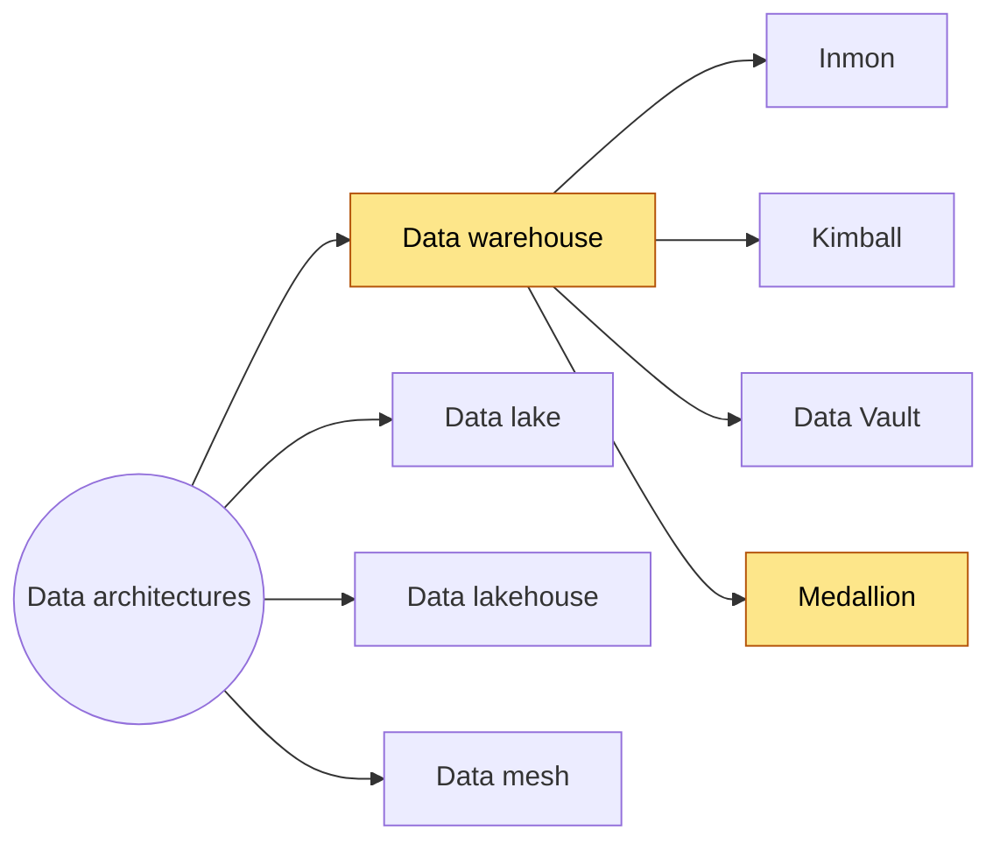
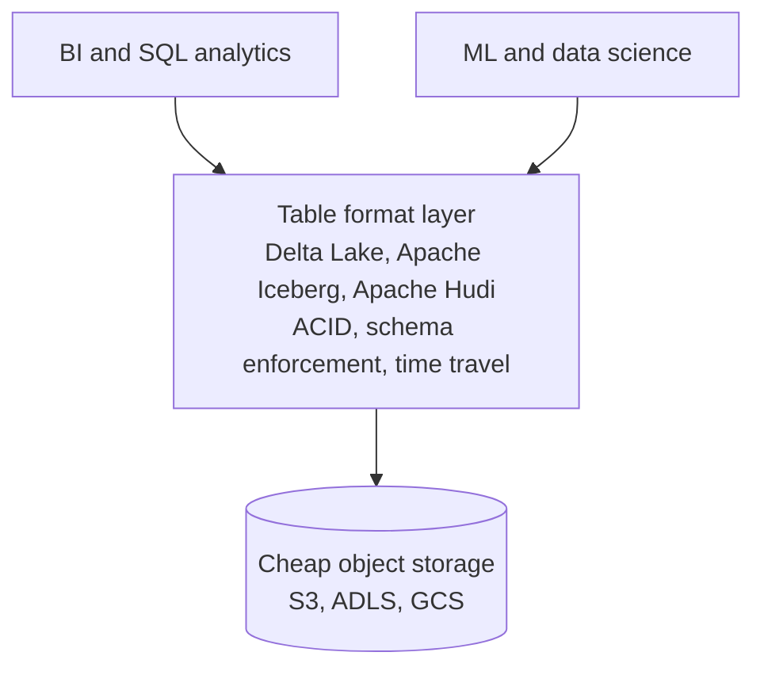
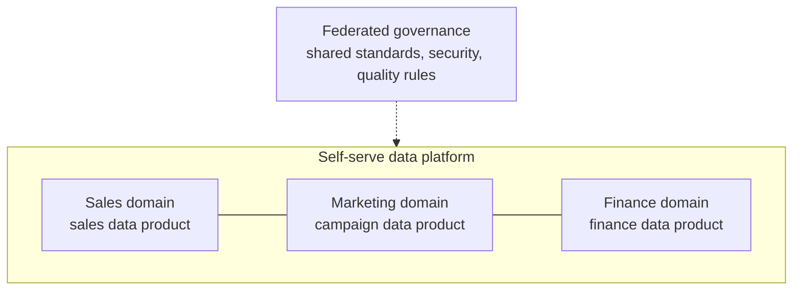
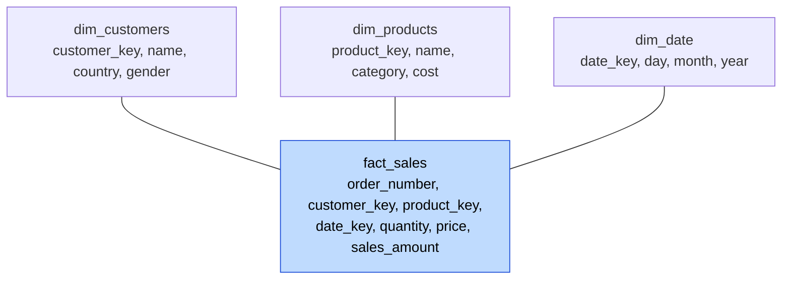
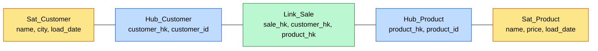
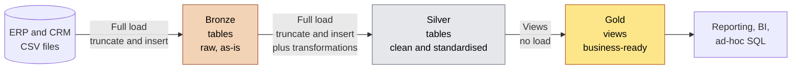
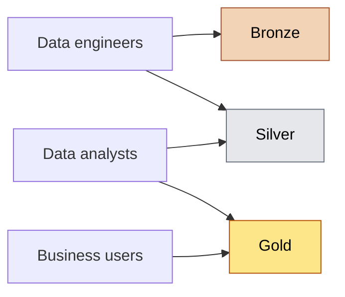

# Data Architectures

## Overview

A data architecture is the overall design for how data is stored, organised and moved around so people can use it. There are four main types. The data warehouse type has four common ways to build it.



The highlighted path is what I'm using for this project: **data warehouse + medallion**.

---

## Part 1: The four data architectures

### Data warehouse

A data warehouse is a central store of **structured**, cleaned data, built for reporting and analytics. Data is modelled before it goes in (schema-on-write), so it's consistent and fast to query with SQL.

- **Data types:** structured, meaning tables, rows and columns
- **Users:** analysts, business users, BI tools
- **Examples:** SQL Server, Snowflake, Google BigQuery, Amazon Redshift, Azure Synapse
- **Pros:** fast queries, trusted numbers, one source of truth for reporting
- **Cons:** only handles structured data well, schema changes take work, storage costs more than a lake

### Data lake

A data lake is cheap storage for **raw data in any format**: tables, JSON, logs, images, video and so on. Data is stored as it arrives, and structure is applied only when you read it (schema-on-read).

- **Data types:** structured, semi-structured and unstructured
- **Users:** data scientists, data engineers, ML workloads
- **Examples:** Amazon S3, Azure Data Lake Storage (ADLS), Google Cloud Storage, HDFS
- **Pros:** very cheap, flexible, and lets you keep data even before you know how you'll use it
- **Cons:** without governance it turns into a "data swamp" nobody trusts, it's slower for BI, and it has no transactions or data quality checks by default

### Data lakehouse

A data lakehouse puts **warehouse features on top of lake storage**. Files sit in cheap object storage, and a table format layer adds the things a warehouse gives you: ACID transactions, schema enforcement, versioning and time travel.



- **Data types:** anything
- **Users:** both BI and ML teams on the same platform
- **Examples:** Databricks, Microsoft Fabric, Snowflake with Iceberg tables
- **Pros:** one platform instead of a separate lake and warehouse, cheap storage, warehouse-like reliability
- **Cons:** more moving parts to set up and govern, and the tooling is still evolving

### Data mesh

A data mesh is **not a technology**. It's a way of organising data ownership. Instead of one central team owning one central platform, each business domain (sales, marketing, finance) owns its data and publishes it as a product other teams can use. Zhamak Dehghani introduced the idea in 2019.

The four principles:

1. **Domain ownership:** the team that knows the data owns it
2. **Data as a product:** shared data has to be documented, reliable and easy to find
3. **Self-serve data platform:** a shared platform so domains don't each build their own infrastructure
4. **Federated governance:** common standards for security, quality and naming, set together and applied everywhere



- **Pros:** scales with big organisations, and domain experts own their own data quality
- **Cons:** needs a mature organisation and strong governance, risks duplicated data and effort, and is overkill for small teams

### Schema-on-write vs schema-on-read

This is the key difference between a warehouse and a lake.

|                           | Schema-on-write                             | Schema-on-read                                 |
| ------------------------- | ------------------------------------------- | ---------------------------------------------- |
| When structure is applied | Before data is stored                       | When data is queried                           |
| Used by                   | Data warehouse                              | Data lake                                      |
| Upside                    | Data is clean and consistent from the start | Load anything fast, decide later               |
| Downside                  | More upfront design, harder to change       | Every reader has to make sense of the raw data |

### Comparison

|                | Warehouse                | Lake                       | Lakehouse                    | Mesh                                       |
| -------------- | ------------------------ | -------------------------- | ---------------------------- | ------------------------------------------ |
| Data types     | Structured               | Any                        | Any                          | Any (depends on domain)                    |
| Schema         | On write                 | On read                    | Enforced by the table format | Set by each domain within shared standards |
| Storage cost   | Higher                   | Low                        | Low                          | Varies                                     |
| BI query speed | Fast                     | Slower                     | Fast                         | Varies                                     |
| Main users     | Analysts, business users | Data scientists, engineers | Both                         | Domain teams                               |
| Main risk      | Rigid, costly to change  | Becomes a data swamp       | Complexity                   | Duplication, needs a mature organisation   |
| Best for       | Structured reporting     | Raw storage, ML            | BI and ML on one platform    | Large organisations with many teams        |

In practice the lines are blurring. Snowflake and BigQuery handle semi-structured data now, and lakehouses are getting more warehouse-like every year.

---

## Part 2: Four ways to build a data warehouse

All four start from source systems and end with data people can query. What changes is the middle.

```mermaid
flowchart TB
    subgraph INMON["Inmon"]
        direction LR
        I1[(Sources)] --> I2[Stage] --> I3["EDW (3NF)"] --> I4[Data marts]
    end
    subgraph KIMBALL["Kimball"]
        direction LR
        K1[(Sources)] --> K2[Stage] --> K3[Data marts]
    end
    subgraph VAULT["Data Vault"]
        direction LR
        V1[(Sources)] --> V2[Stage] --> V3[Raw vault] --> V4[Business vault] --> V5[Data marts]
    end
    subgraph MEDAL["Medallion"]
        direction LR
        M1[(Sources)] --> M2[Bronze] --> M3[Silver] --> M4[Gold]
    end
    classDef bronze fill:#f3d3b5,stroke:#a0522d,color:#000
    classDef silver fill:#e5e7eb,stroke:#6b7280,color:#000
    classDef gold fill:#fde68a,stroke:#b45309,color:#000
    class M2 bronze
    class M3 silver
    class M4 gold
```



A few terms first:

- **Stage:** a landing area where source data is copied before processing
- **Data mart:** a smaller, subject-focused slice of the warehouse (sales, finance, HR) built for one group of users
- **EDW:** enterprise data warehouse, the one central integrated store

### Inmon (top-down)

Bill Inmon is often called the father of data warehousing.

**Flow:** Sources → Stage → EDW (3NF) → Data marts

**How it works:** you build one big, fully integrated enterprise data warehouse first. It's modelled in **third normal form (3NF)**, which means data is split into many related tables so every fact is stored only once. Data marts are then built from the EDW for each department.

**3NF in one line:** the customer's city lives in a `cities` table and the customer row just stores a `city_id`, so there's no repeated data.

- **Pros:** a single source of truth, very consistent, little redundancy, and it handles change well
- **Cons:** slow and expensive to build, needs heavy upfront design, and users wait a long time before seeing anything useful
- **Best for:** large enterprises that need one integrated, governed view of everything

### Kimball (bottom-up)

Ralph Kimball wrote *The Data Warehouse Toolkit*, the standard book on dimensional modelling.

**Flow:** Sources → Stage → Data marts

**How it works:** you skip the big central EDW and build data marts straight away using **dimensional modelling**. Data is shaped into a **star schema**:

- **Fact tables** hold events and measurements, like sales, quantity and amount
- **Dimension tables** hold descriptive context, like customer, product and date



To stop marts drifting apart, Kimball uses **conformed dimensions**: the same `dim_customers` is shared by the sales mart and the marketing mart, so numbers match across them. A **bus matrix** (a grid of business processes against dimensions) plans which dimensions each mart shares.

- **Pros:** fast to deliver, easy for business users to understand, and great query performance
- **Cons:** marts get inconsistent if conformed dimensions aren't managed, and the design is harder to change later
- **Best for:** delivering BI and reporting quickly

### Data Vault

Dan Linstedt created Data Vault. The current version is Data Vault 2.0.

**Flow:** Sources → Stage → Raw vault → Business vault → Data marts

**How it works:** data is modelled into three kinds of tables:

- **Hubs** hold the unique business keys, like customer ID and product ID
- **Links** hold the relationships between hubs, like a sale linking a customer and a product
- **Satellites** hold the descriptive details and their history, like customer name and city over time



- **Raw vault:** source data loaded into hubs, links and satellites with no business rules applied
- **Business vault:** extra tables where business rules and calculations are applied
- **Data marts** (also called information marts): usually star schemas built on top, for users

Every row carries a load date and a record source, and data is insert-only, so you get a full audit trail.

- **Pros:** very flexible when sources change, keeps full history, auditable, and scales well
- **Cons:** lots of tables, complex to query directly, steep learning curve, and it always needs marts on top for users
- **Best for:** many changing sources, regulated industries, anywhere auditing matters

### Medallion

Databricks popularised medallion. It's also called a multi-hop architecture.

**Flow:** Sources → Bronze → Silver → Gold

**How it works:** data moves through three layers and gets cleaner and more business-ready at each step (full details in Part 3).

Medallion is a **layering pattern**, not a modelling method. It says what each layer is for, not how to model the tables. That's why the gold layer usually borrows Kimball's star schema. My project combines the two: medallion for the layers, star schema in gold.

- **Pros:** simple to understand, each layer has one clear job, easy to debug, and works on any platform
- **Cons:** some data is duplicated across layers, and it still needs a proper model in gold
- **Best for:** modern data platforms and projects of any size that want a clear pipeline

### Comparison

|                       | Inmon                                  | Kimball           | Data Vault                 | Medallion                        |
| --------------------- | -------------------------------------- | ----------------- | -------------------------- | -------------------------------- |
| Approach              | Top-down                               | Bottom-up         | Hybrid                     | Layered                          |
| Core model            | 3NF EDW                                | Star schema marts | Hubs, links, satellites    | Layers, with star schema in gold |
| History               | Possible                               | Through SCDs      | Full, built in             | Optional (SCDs in gold)          |
| Time to first results | Slow                                   | Fast              | Medium to slow             | Fast                             |
| Complexity            | High                                   | Low to medium     | High                       | Low to medium                    |
| Best for              | Enterprise-wide single source of truth | Quick BI delivery | Changing sources, auditing | Clear, modern pipelines          |

---

## Part 3: Medallion layers in detail



### Layer comparison

|                               | Bronze                                    | Silver                                                                          | Gold                                                         |
| ----------------------------- | ----------------------------------------- | ------------------------------------------------------------------------------- | ------------------------------------------------------------ |
| **Definition**          | Raw, unprocessed data, as-is from sources | Clean and standardised data                                                     | Business-ready data                                          |
| **Objective**           | Traceability and debugging                | Intermediate layer: prepare data for analysis                                   | Provide data for reporting and analytics                     |
| **Object type**         | Tables                                    | Tables                                                                          | Views                                                        |
| **Load method**         | Full load (truncate and insert)           | Full load (truncate and insert)                                                 | None                                                         |
| **Data transformation** | None (as-is)                              | Data cleaning, standardisation, normalisation, derived columns, data enrichment | Data integration, data aggregation, business logic and rules |
| **Data modelling**      | None (as-is)                              | None (as-is)                                                                    | Star schema, aggregated objects, flat tables                 |
| **Target audience**     | Data engineers                            | Data analysts, data engineers                                                   | Data analysts, business users                                |

### Who uses which layer



### Bronze layer

**Job:** keep an exact copy of the source data.

- Stored as **tables**, with the same structure and column names as the source.
- **Full load, truncate and insert:** empty the table, then reload everything from the source files each run.
- **No transformations, no modelling.** Even obviously bad data stays as it is.

**Why keep raw data untouched?**

- **Traceability:** if a number in a report looks wrong, check bronze to see whether the source sent it that way or the pipeline broke it.
- **Debugging and reruns:** if silver logic has a bug, fix it and rebuild silver from bronze without going back to the source systems.

**Tips:**

- Name tables after the source, e.g. `bronze.crm_customers`, `bronze.erp_sales`.
- Only data engineers should work here.

### Silver layer

**Job:** make the data clean and trustworthy.

- Stored as **tables**, usually one silver table per bronze table, with the same structure.
- **Full load, truncate and insert**, with the cleaning applied during the insert.
- **Transformations** (details in the ETL notes):
  - data cleaning: duplicates, NULLs, invalid values, spaces, data types
  - standardisation and normalisation: `M` / `F` → `Male` / `Female`, consistent formats
  - derived columns: new columns calculated from existing ones
  - data enrichment: adding useful info from other data
- **No data modelling yet.** It's still organised like the source; it's just clean now.

**Tip:** it's common to add a technical metadata column so you know when each row was loaded:

```sql
dwh_create_date DATETIME2 DEFAULT GETDATE()
```

### Gold layer

**Job:** turn clean data into something the business can use.

- Built as **views** on top of silver, not tables.
- **No load method**, because a view doesn't store data. It runs its query against silver every time someone uses it.
- **Transformations:**
  - data integration: combining CRM and ERP into one model
  - data aggregation: summarising where useful
  - business logic and rules: company-specific calculations and definitions
- **Data modelling:** this is the first layer with a proper model.

**Why views?**

- Nothing to load or schedule, and gold is always in sync with silver.
- No extra storage.
- The trade-off is that the query runs each time. With big data you'd switch gold to physical tables to make it faster.

**Three modelling options in gold:**

| Option             | What it is                                                    | When to use                                             |
| ------------------ | ------------------------------------------------------------- | ------------------------------------------------------- |
| Star schema        | Fact tables surrounded by dimension tables                    | The default for analytics and BI tools                  |
| Aggregated objects | Pre-summarised tables or views, e.g. monthly sales per region | Dashboards that hit the same summary over and over      |
| Flat tables        | One wide table with everything already joined                 | Users who want one table to drop into Excel or Power BI |

Example gold dimension view, joining CRM and ERP and creating a surrogate key:

```sql
CREATE VIEW gold.dim_customers AS
SELECT
    ROW_NUMBER() OVER (ORDER BY c.customer_id) AS customer_key,  -- surrogate key
    c.customer_id,
    c.first_name,
    c.last_name,
    l.country,
    c.gender
FROM silver.crm_customers c
LEFT JOIN silver.erp_customer_locations l
    ON c.customer_id = l.customer_id;
```

**Tips:**

- Use business-friendly names: `dim_` and `fact_` prefixes, and readable column names (`customer_key`, not `cst_k`).
- Surrogate keys (generated IDs like `customer_key`) connect facts to dimensions, so the model doesn't depend on source system IDs.
- This is the only layer business users should touch.

### Separation of concerns

The whole point of medallion is that each layer does one job and nothing else:

- **Bronze** stores the data, without changing it
- **Silver** fixes the data quality
- **Gold** adds business meaning and the model

If cleaning creeps into bronze, or business rules creep into silver, you lose the ability to trace and debug cleanly.
