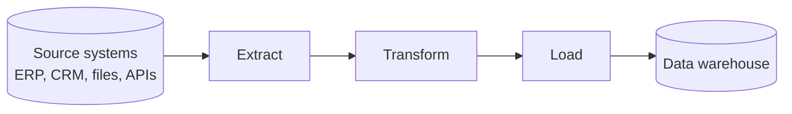
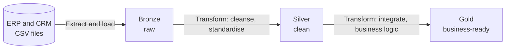
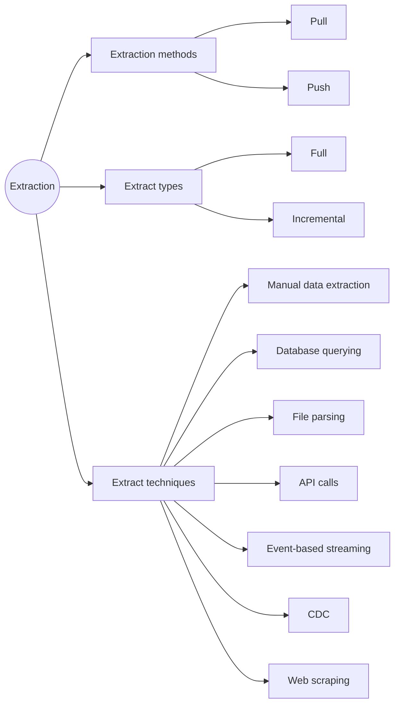
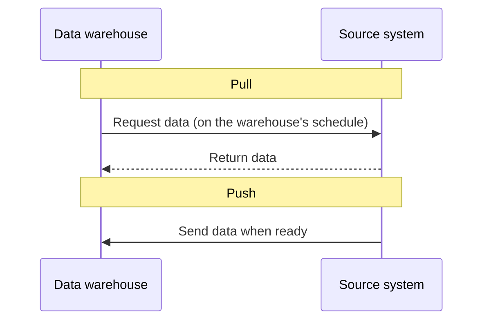
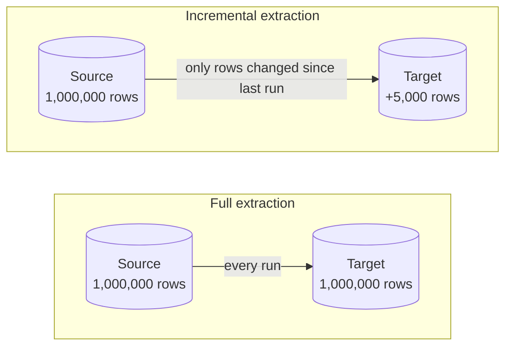
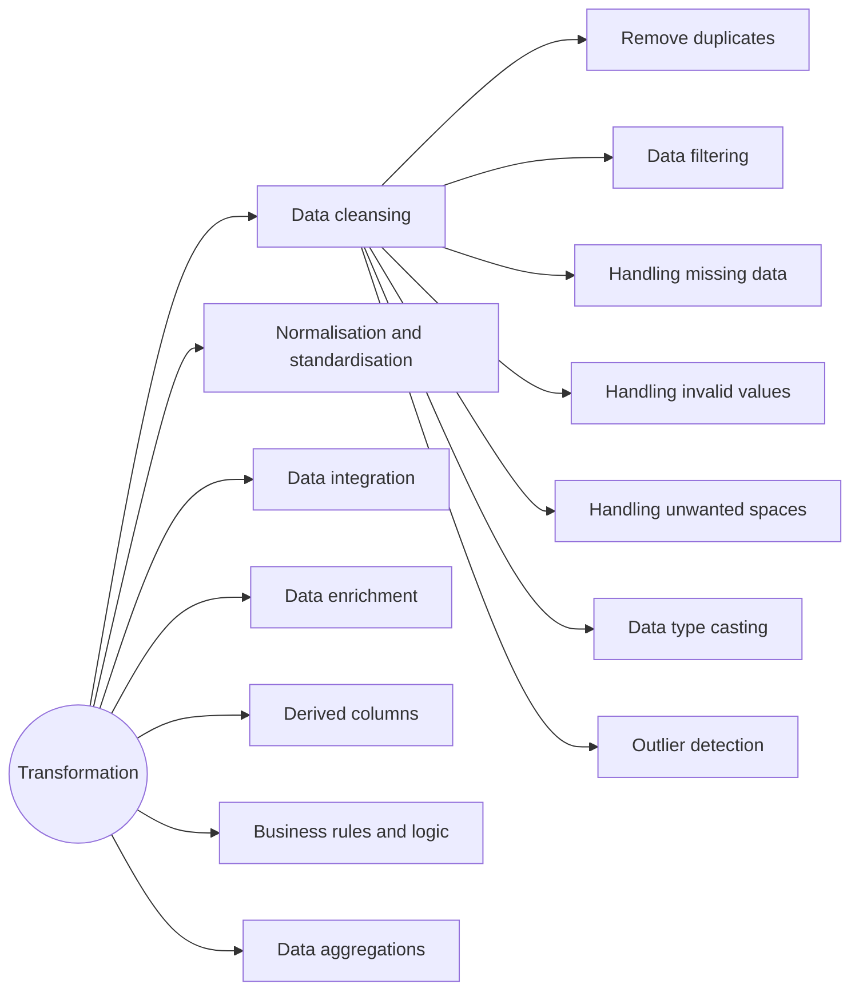
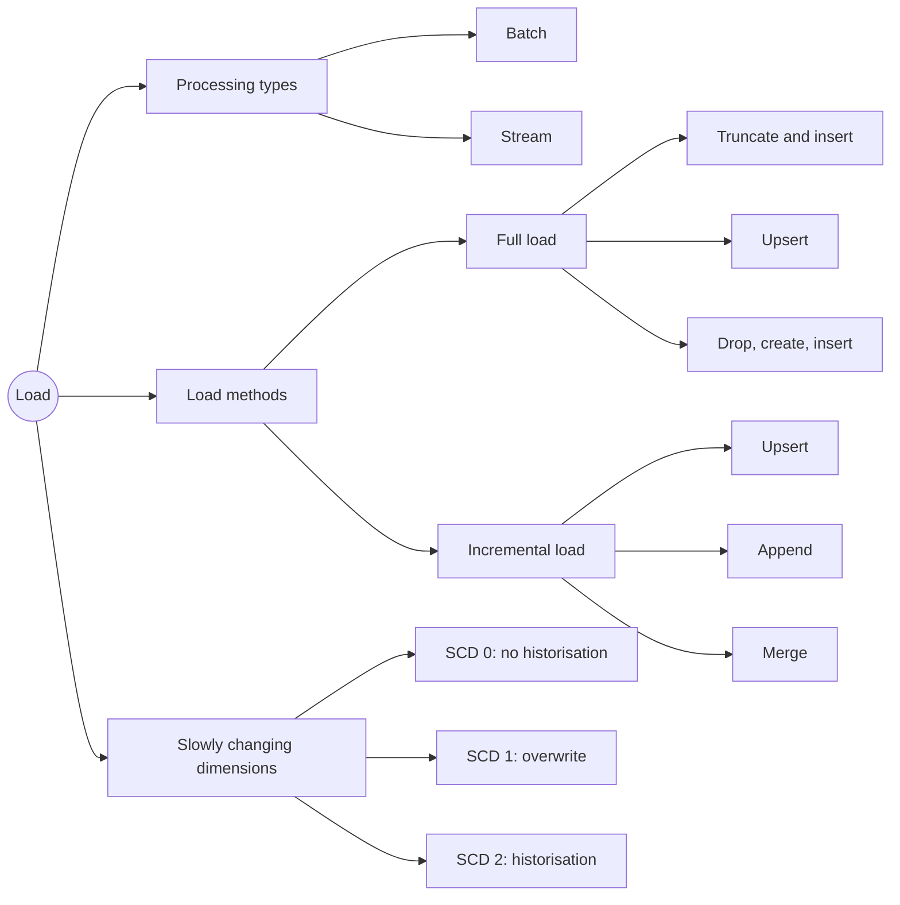

# ETL Basics and Techniques

## What ETL is

ETL stands for **Extract, Transform, Load**. It's how data gets from where it's created (source systems) to where it's analysed (the data warehouse), and gets fixed up along the way.

- **Extract:** get the data out of the source systems
- **Transform:** clean it, reshape it, apply business logic
- **Load:** write it into the target tables



### ETL vs ELT

Both have the same three steps in a different order.

|                              | ETL                                            | ELT                                                     |
| ---------------------------- | ---------------------------------------------- | ------------------------------------------------------- |
| Order                        | Transform before loading                       | Load raw data first, transform inside the target        |
| Where transformation happens | Separate ETL tool or server                    | Inside the warehouse, usually with SQL                  |
| Raw data kept in target?     | Usually no                                     | Yes                                                     |
| Common with                  | Traditional on-prem setups (SSIS, Informatica) | Cloud warehouses (Snowflake, BigQuery, Databricks), dbt |

### How it fits the medallion layers

In a medallion warehouse, ETL isn't one single step. It happens between every layer.



- **Sources → Bronze:** extract and load only, no transformation
- **Bronze → Silver:** cleansing and standardisation
- **Silver → Gold:** integration and business logic

Since everything after bronze happens with SQL inside SQL Server, this setup is technically closer to ELT. Most people still call it ETL.

---

## 1. Extract

Extraction gets the data out of the source systems. There are three things to decide:

- the **method**, meaning who starts the transfer
- the **type**, meaning how much data you take
- the **technique**, meaning how you actually read it



### Extraction methods: pull vs push

**Pull extraction:** the warehouse side goes to the source and asks for the data, on its own schedule. For example, a nightly SQL job queries the ERP database, or a script reads CSVs from a shared folder.

**Push extraction:** the source system sends the data to the target whenever it's ready. For example, the CRM drops an export file into cloud storage every night, or sends events to a message queue.



|                    | Pull                                 | Push                                |
| ------------------ | ------------------------------------ | ----------------------------------- |
| Who's in control   | Target (warehouse)                   | Source system                       |
| Timing             | Warehouse's schedule                 | Whenever the source is ready        |
| Load on the source | Can be heavy if the queries are big  | Source decides how and when         |
| Typical use        | Batch loads, DB queries, API polling | Event streams, webhooks, file drops |

### Extract types: full vs incremental

**Full extraction:** take everything, every run.

- Simple, with no need to track what changed
- Always gives a complete, consistent copy
- Gets slow and expensive as tables grow

**Incremental extraction:** only take rows that are new or changed since the last run.

- Much faster on big tables
- Needs a reliable way to spot changes. Common options:
  - a timestamp column like `last_modified`
  - an ID that only ever goes up
  - CDC (see techniques below)
- Deletes are hard to catch unless the source marks them with a soft-delete flag, or you use CDC



A common incremental pattern uses a **watermark**, which is the highest timestamp loaded last time:

```sql
-- only grab rows changed since the last successful load
SELECT *
FROM source.orders
WHERE last_modified > (
    SELECT last_load_time
    FROM etl.load_log
    WHERE table_name = 'orders'
);
```

After the load, update the watermark to the new max `last_modified`.

### Extract techniques

| Technique                 | How it works                                                                 | Example                                          | Watch out for                                                          |
| ------------------------- | ---------------------------------------------------------------------------- | ------------------------------------------------ | ---------------------------------------------------------------------- |
| Manual data extraction    | Someone exports the data by hand                                             | Downloading an Excel report from a web portal    | Not repeatable or reliable. Fine for one-offs only                     |
| Database querying         | Run SQL against the source database                                          | `SELECT * FROM erp.customers`                  | Big queries can slow the source system down                            |
| File parsing              | Read structured files                                                        | CSV, JSON, XML, Excel, Parquet                   | Delimiters, headers, encoding, date formats                            |
| API calls                 | Request data from a REST or GraphQL endpoint                                 | Pulling orders from an e-commerce platform's API | Auth, pagination, rate limits                                          |
| Event-based streaming     | Consume events from a stream in real time                                    | Kafka, Azure Event Hubs, AWS Kinesis             | More complex to build and run                                          |
| CDC (change data capture) | Read the database's transaction log to catch every insert, update and delete | SQL Server CDC, Debezium                         | Needs setting up on the source, but has low impact and catches deletes |
| Web scraping              | Pull data out of a web page's HTML                                           | Competitor prices from a website                 | Breaks when the site changes. Check the site's terms and the legality  |

---

## 2. Transform

Transformation turns raw data into something clean, consistent and useful. It's usually the biggest chunk of the work.



### Data cleansing

Cleansing fixes data quality problems so the data can be trusted. Most of the silver layer work is this.

| Task                     | What it means                            | SQL Server example                                                                     |
| ------------------------ | ---------------------------------------- | -------------------------------------------------------------------------------------- |
| Remove duplicates        | Keep one row per business key            | `ROW_NUMBER() OVER (PARTITION BY cst_id ORDER BY create_date DESC)`, then keep row 1 |
| Data filtering           | Drop rows you don't need                 | `WHERE is_test_account = 0`                                                          |
| Handling missing data    | Deal with NULLs and blanks               | `COALESCE(country, 'n/a')`, `ISNULL(cost, 0)`                                      |
| Handling invalid values  | Fix values that can't be right           | `CASE WHEN birth_date > GETDATE() THEN NULL ELSE birth_date END`                     |
| Handling unwanted spaces | Strip leading and trailing spaces        | `TRIM(first_name)`                                                                   |
| Data type casting        | Convert columns to the right type        | `TRY_CAST(price AS DECIMAL(10,2))`                                                   |
| Outlier detection        | Spot values far outside the normal range | Flag sales above Q3 + 1.5 × IQR                                                       |

Details worth remembering:

- **Missing data** has a few options: leave it NULL, replace it with a default (`'n/a'`, `'Unknown'`, `0`), derive it from other columns, or drop the row. Which one depends on how the column gets used.
- **Invalid values** include negative prices, birth dates in the future, an order date after the ship date, and sales that don't equal quantity × price.
- **TRY_CAST** returns NULL instead of throwing an error when a value can't convert, which is handy for messy data.
- **Outliers** aren't always errors. Flag them and check before deleting anything. Two common methods:
  - the IQR rule: anything below Q1 − 1.5 × IQR or above Q3 + 1.5 × IQR
  - a z-score above 3
- **Dates stored as integers** are common in ERP exports (`20250103`). Check the value is 8 digits and not 0, then cast:

```sql
CASE
    WHEN order_dt = 0 OR LEN(order_dt) != 8 THEN NULL
    ELSE CAST(CAST(order_dt AS VARCHAR) AS DATE)
END AS order_date
```

Removing duplicates, keeping the latest record per customer:

```sql
SELECT *
FROM (
    SELECT *,
           ROW_NUMBER() OVER (PARTITION BY cst_id ORDER BY create_date DESC) AS rn
    FROM bronze.customers
    WHERE cst_id IS NOT NULL
) t
WHERE rn = 1;
```

#### Before and after

|         | cst_id | first_name    | gender | marital_status | create_date |
| ------- | ------ | ------------- | ------ | -------------- | ----------- |
| Raw     | 29466  | `"  Sara "` | F      | M              | 20250103    |
| Cleaned | 29466  | Sara          | Female | Married        | 2025-01-03  |

#### Quick checks to find issues

Run these on bronze before writing the silver logic:

```sql
-- duplicates or NULLs in the key
SELECT cst_id, COUNT(*) AS cnt
FROM bronze.customers
GROUP BY cst_id
HAVING COUNT(*) > 1 OR cst_id IS NULL;

-- unwanted spaces
SELECT first_name
FROM bronze.customers
WHERE first_name != TRIM(first_name);

-- every value a code column uses
SELECT DISTINCT gender
FROM bronze.customers;

-- invalid date order
SELECT *
FROM bronze.sales
WHERE order_date > ship_date;
```

### Normalisation and standardisation

This step makes values consistent and readable:

- Map codes to friendly values: `M` / `F` → `Male` / `Female`
- Merge different spellings of the same thing: `US`, `USA`, `United States` → `United States`
- Use one date format, one currency and one unit of measure

```sql
CASE UPPER(TRIM(gender))
    WHEN 'M' THEN 'Male'
    WHEN 'F' THEN 'Female'
    ELSE 'n/a'
END AS gender
```

Heads up: "normalisation" here means standardising values. It's not database normalisation (1NF, 2NF, 3NF), which is about splitting tables to remove redundancy.

### Data integration

Integration combines data from different sources into one model. For example, customer names come from the CRM and customer location comes from the ERP. Join them on the customer key and you get one customer table.

Things to sort out:

- Keys don't always match between systems because of different formats or prefixes, so you may need to clean the key first.
- When two sources disagree on the same field, decide which one is the master source.

### Data enrichment

Enrichment adds information that wasn't in the original row, usually from another dataset. Examples are adding a region from a country lookup table, or a product category from a reference table.

### Derived columns

Derived columns are new columns calculated from existing ones:

- `sales_amount = quantity * price`
- age from birth date
- splitting a product key like `CO-RF-FR-R92B-58` into a category ID (`CO-RF`) and a product number (`FR-R92B-58`)

```sql
SUBSTRING(prd_key, 1, 5)           AS cat_id,
SUBSTRING(prd_key, 7, LEN(prd_key)) AS prd_number
```

### Business rules and logic

These are company-specific rules applied to the data. Examples:

- If sales is missing or wrong, recalculate it as quantity × price
- If price is missing, derive it as sales ÷ quantity
- Tag customers who spent over a set amount as "VIP"
- Set a product's end date to the day before its next start date

### Data aggregations

Aggregation summarises detail rows to a higher level, such as total sales per product per month. It usually happens in the gold layer or in reporting, because aggregating too early throws away detail you might need later.

```sql
SELECT product_key,
       YEAR(order_date)  AS order_year,
       MONTH(order_date) AS order_month,
       SUM(sales_amount) AS total_sales
FROM gold.fact_sales
GROUP BY product_key, YEAR(order_date), MONTH(order_date);
```

### Which layer does what

| Transformation                    | Silver | Gold                 |
| --------------------------------- | ------ | -------------------- |
| Data cleansing                    | ✓     |                      |
| Normalisation and standardisation | ✓     |                      |
| Derived columns                   | ✓     |                      |
| Data enrichment                   | ✓     |                      |
| Data integration                  |        | ✓                   |
| Business rules and logic          | ✓     | ✓                   |
| Data aggregations                 |        | ✓ (or in reporting) |

---

## 3. Load

Loading writes the transformed data into the target tables. There are three decisions:

- the processing type
- the load method
- how to handle changes over time (SCD)



### Processing types: batch vs stream

|            | Batch                                | Stream                                   |
| ---------- | ------------------------------------ | ---------------------------------------- |
| How        | Load data in chunks on a schedule    | Process each record as it arrives        |
| Latency    | Minutes to hours (e.g. nightly)      | Seconds or less                          |
| Complexity | Simpler and cheaper                  | Harder to build and run                  |
| Tools      | SQL Server Agent jobs, SSIS, Airflow | Kafka, Spark Structured Streaming, Flink |
| Good for   | Daily reports, dashboards            | Fraud detection, live tracking           |

Batch covers most reporting needs. Only go for streaming if the business genuinely needs data within seconds.

### Load methods

**Full load** reloads the whole table every time. There are three ways to do it:

- **Truncate and insert:** empty the table with `TRUNCATE`, then insert everything. It's fast, and the table structure, indexes and permissions all stay. This is the most common full load.
- **Upsert:** update rows that already exist and insert the new ones, using the full dataset.
- **Drop, create, insert:** drop the whole table, recreate it, then insert. It's useful when the table structure changes, but you lose indexes, permissions and constraints unless you recreate them too.

**Incremental load** only loads what's new or changed. There are three ways to do it:

- **Upsert:** update matching rows and insert new ones.
- **Append:** only insert new rows and never update. This works for logs, events and transactions that don't change once written.
- **Merge:** update, insert, and also delete rows that are gone from the source.

| Method               | Inserts new | Updates existing  | Removes deleted   | Speed on big tables |
| -------------------- | ----------- | ----------------- | ----------------- | ------------------- |
| Truncate and insert  | ✓          | ✓ (by reloading) | ✓ (by reloading) | Slow                |
| Drop, create, insert | ✓          | ✓ (by reloading) | ✓ (by reloading) | Slow                |
| Upsert               | ✓          | ✓                | ✗                | Fast                |
| Append               | ✓          | ✗                | ✗                | Fastest             |
| Merge                | ✓          | ✓                | ✓                | Fast                |

Truncate and insert in SQL Server:

```sql
TRUNCATE TABLE bronze.crm_customers;

BULK INSERT bronze.crm_customers
FROM 'C:\data\source_crm\customers.csv'
WITH (
    FIRSTROW = 2,           -- skip the header row
    FIELDTERMINATOR = ',',
    TABLOCK                 -- lock the table for a faster load
);
```

Merge in SQL Server:

```sql
MERGE silver.customers AS tgt
USING staging.customers AS src
    ON tgt.customer_id = src.customer_id
WHEN MATCHED THEN
    UPDATE SET tgt.name = src.name,
               tgt.city = src.city
WHEN NOT MATCHED BY TARGET THEN
    INSERT (customer_id, name, city)
    VALUES (src.customer_id, src.name, src.city)
WHEN NOT MATCHED BY SOURCE THEN
    DELETE;   -- MERGE has to end with a semicolon
```

Take out the `WHEN NOT MATCHED BY SOURCE` part and you've got an upsert.

### Slowly changing dimensions (SCD)

Dimension data changes now and then: a customer moves city, or a product changes category. SCD is how you decide what happens to the old value when that happens.

Every example below uses the same case: customer C001, Sara, moves from Leeds to London on 1 March 2025.

**SCD 0: no historisation (keep the original)**

The value never changes in the warehouse, even when the source changes. Use it for things that shouldn't change, like date of birth or the original sign-up date.

| customer_id | name | city                                    |
| ----------- | ---- | --------------------------------------- |
| C001        | Sara | Leeds (stays Leeds even after the move) |

**SCD 1: overwrite**

Replace the old value with the new one and keep no history. It's simple, and reports always show the current value.

|        | customer_id | name | city   |
| ------ | ----------- | ---- | ------ |
| Before | C001        | Sara | Leeds  |
| After  | C001        | Sara | London |

The downside is that her old sales now look like they happened in London.

**SCD 2: full history**

Keep the old row, close it off, and add a new row for the new value. Because customer_id now appears more than once, you need a surrogate key, plus a start date, an end date and usually a current flag.

| customer_key | customer_id | name | city   | start_date | end_date   | is_current |
| ------------ | ----------- | ---- | ------ | ---------- | ---------- | ---------- |
| 1            | C001        | Sara | Leeds  | 2023-06-10 | 2025-02-28 | N          |
| 2            | C001        | Sara | London | 2025-03-01 | NULL       | Y          |

Old sales link to key 1 (Leeds) and new sales link to key 2 (London), so the history stays accurate.

**Other types worth knowing**

- **SCD 3:** add a column for the previous value (`current_city`, `previous_city`). It only keeps one step of history.
- **SCD 4:** keep current values in the main table and history in a separate history table.
- **SCD 6:** a mix of types 1, 2 and 3.

| Type  | What happens          | History kept          | Complexity |
| ----- | --------------------- | --------------------- | ---------- |
| SCD 0 | Nothing changes       | None (original value) | Lowest     |
| SCD 1 | Overwrite             | None                  | Low        |
| SCD 2 | New row per change    | Full                  | Higher     |
| SCD 3 | Previous-value column | One step              | Medium     |

---

## Choices for this project

| Decision          | Choice                                                                                                       | Why                                                  |
| ----------------- | ------------------------------------------------------------------------------------------------------------ | ---------------------------------------------------- |
| Extraction method | Pull                                                                                                         | I read the CSV files in myself                       |
| Extract type      | Full extraction                                                                                              | Requirements say latest dataset only                 |
| Extract technique | File parsing                                                                                                 | ERP and CRM data comes as CSV files                  |
| Transformations   | Cleansing, standardisation, derived columns and enrichment in silver. Integration and business rules in gold | Matches the medallion layers                         |
| Processing type   | Batch                                                                                                        | No need for real-time data                           |
| Load method       | Full load, truncate and insert                                                                               | Simple, and fits reloading the latest data each time |
| SCD               | SCD 1 (overwrite)                                                                                            | No historisation required                            |
