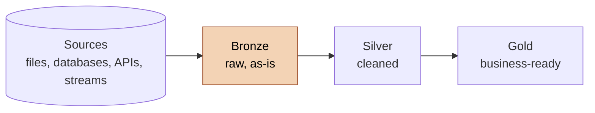

# Bronze Layer: Learning Notes

## What it is

The bronze layer is the first stop in a medallion architecture. It stores data exactly as it arrives from the source: no cleaning, no fixing, no business logic. If the source sends a duplicate, a NULL or a nonsense date, bronze keeps it.

You'll also see it called the raw layer, the landing zone or the staging layer, depending on the team. Databricks, who popularised medallion, describes it as the place where raw data lands, with extra metadata like load time and source file added.



## Core characteristics

| Property | Bronze |
|---|---|
| Content | Raw data, as it came from the source |
| Purpose | Traceability and debugging |
| Transformations | None (or only harmless technical additions, see below) |
| Data model | None. Mirrors the source structure |
| Object type | Tables (or files in a lake) |
| Typical load | Batch, full load or incremental depending on the source |
| Audience | Data engineers, not business users |

## Why keep it raw

1. **Traceability:** when a number in a report looks wrong, bronze tells you whether the source sent it that way or your pipeline changed it.
2. **Reprocessing:** if you find a bug in your cleaning logic, you fix it and rebuild silver from bronze. You don't have to ask the source system for the data again, which may be slow, impossible, or no longer available.
3. **Audit and history:** an untouched copy is evidence of what was received and when.
4. **Decoupling:** loading and cleaning are separate jobs, so a failure in one doesn't force you to redo the other.

The rule that holds all of this together: **don't fix anything in bronze.** The moment you clean data on the way in, you can no longer tell what the source really sent.

---

## What goes into a bronze table

### Mirror the source

- Keep the source's column names, order and structure.
- One bronze table per source table or file.
- Name tables after their source, for example `<sourcesystem>_<entity>`.

### Be forgiving with data types

Bronze must not reject data. A load that fails because one row has `N/A` in a number column is worse than a load that accepts it and lets silver deal with it.

| Situation | What to do in bronze |
|---|---|
| Number column sometimes contains text | Store as `NVARCHAR` and convert in silver |
| Dates stored as integers like `20250103` | Store as `INT` or text, convert in silver |
| Unsure about decimals | Use `DECIMAL` rather than `INT`, so nothing gets cut off |
| Text of unknown length | Be generous with the size |

### Optional metadata columns

Adding columns that describe the load, not the data itself, is normal and doesn't break the "no transformation" rule:

| Column | Purpose |
|---|---|
| `load_timestamp` | When the row was loaded |
| `source_file_name` | Which file or system it came from |
| `batch_id` | Which load run brought it in |

Prefix them so they're clearly technical, for example `dwh_load_date`.

---

## Loading strategies

### Full load (truncate and insert)

Empty the table, then reload everything.

- Simple, with no logic for tracking what changed
- Always gives a complete, consistent copy
- Slow on large tables
- Doesn't keep history on its own, because each run overwrites the last

### Incremental load

Load only new or changed rows, using a watermark such as a `last_modified` timestamp or an ever-increasing ID.

- Much faster on big tables
- Needs a reliable way to detect changes
- Deletes in the source are hard to catch without CDC or a soft-delete flag

### Append-only (keeping history)

Insert every load as new rows, tagged with a load timestamp, and never delete. Bronze then becomes a full history of everything the source ever sent. This costs more storage but gives you complete traceability, and it's common in cloud lakehouses.

| | Full load | Incremental | Append-only |
|---|---|---|---|
| Speed on big data | Slow | Fast | Fast |
| Complexity | Low | Medium | Medium |
| Keeps history | No | No | Yes |
| Good for | Small sources, simple pipelines | Large, frequently updated sources | Audit needs, event data |

---

## Example: loading a CSV in SQL Server

Names here are generic. Swap in your own.

```sql
-- create the landing table: same columns as the file, loose types
CREATE TABLE bronze.source_customers (
    customer_id   NVARCHAR(50),
    full_name     NVARCHAR(100),
    signup_date   NVARCHAR(50),
    country       NVARCHAR(50)
);
GO

-- full load: empty it, then bulk load the file
TRUNCATE TABLE bronze.source_customers;

BULK INSERT bronze.source_customers
FROM 'C:\data\customers.csv'
WITH (
    FIRSTROW = 2,            -- skip the header row
    FIELDTERMINATOR = ',',   -- columns separated by commas
    ROWTERMINATOR = '\n',    -- rows separated by new lines
    TABLOCK                  -- lock the table for a faster load
);
```

| Option | Meaning |
|---|---|
| `FIRSTROW = 2` | Start at row 2, skipping the header |
| `FIELDTERMINATOR` | The character that separates columns |
| `ROWTERMINATOR` | The character that ends a row |
| `TABLOCK` | Locks the table during the load, which is faster |
| `FORMAT = 'CSV'` | Handles quoted fields properly (SQL Server 2017 and later) |
| `CODEPAGE = '65001'` | Reads the file as UTF-8 |
| `ERRORFILE` | Writes rows that failed to load into a file so you can inspect them |

### Wrap it in a stored procedure

Put the loads for all the tables into one stored procedure, so the whole layer loads with one command, for example `EXEC bronze.load_bronze;`. A good one:

- prints which table it's on
- times each load with `GETDATE()` and `DATEDIFF`
- uses `TRY ... CATCH` to report errors with `ERROR_MESSAGE()`, `ERROR_NUMBER()` and `ERROR_STATE()`

```sql
CREATE OR ALTER PROCEDURE bronze.load_bronze AS
BEGIN
    DECLARE @start_time DATETIME, @end_time DATETIME;

    BEGIN TRY
        SET @start_time = GETDATE();
        TRUNCATE TABLE bronze.source_customers;
        BULK INSERT bronze.source_customers
        FROM 'C:\data\customers.csv'
        WITH (FIRSTROW = 2, FIELDTERMINATOR = ',', TABLOCK);
        SET @end_time = GETDATE();
        PRINT 'Duration: ' + CAST(DATEDIFF(SECOND, @start_time, @end_time) AS NVARCHAR) + ' seconds';
    END TRY
    BEGIN CATCH
        PRINT 'Error: ' + ERROR_MESSAGE();
    END CATCH
END;
GO
```

---

## Common problems

| Problem | Likely cause | Fix |
|---|---|---|
| "Cannot bulk load, file could not be opened" | The SQL Server service account can't read that folder, or the path doesn't exist from the server's point of view | Grant read access, or put the file somewhere the server can reach |
| Conversion or type errors | Table types are stricter than the real data | Loosen the column type in bronze |
| Everything in one column | Wrong delimiter | Check `FIELDTERMINATOR`, since some files use `;` or tabs |
| Columns shifted or split | Commas inside text fields | Use `FORMAT = 'CSV'` and a quote character |
| Row count off by one | The header row got loaded | Set `FIRSTROW = 2` |
| Duplicate rows after a rerun | Forgot to truncate before a full load | `TRUNCATE` first |
| Garbled special characters | Encoding mismatch | Set the code page, for example UTF-8 |

---

## Checking a bronze load

Bronze isn't cleaned, but it should still be verified:

1. **Row counts:** compare against the source file (minus the header).
2. **Spot check:** `SELECT TOP 10 *` and look for values in the wrong columns.
3. **No empty tables:** a table with zero rows means the load found nothing.
4. **Load time:** a load that's suddenly much faster or slower than usual is worth a look.

```sql
SELECT COUNT(*) AS row_count FROM bronze.source_customers;
SELECT TOP 10 * FROM bronze.source_customers;
```

Don't check for duplicates, NULLs or odd values here. Those problems are expected in bronze, and finding and fixing them is silver's job.

---

## Bronze across different platforms

The idea is the same everywhere, only the storage changes.

| Platform | What bronze looks like |
|---|---|
| SQL Server or another database | Tables in a `bronze` schema |
| Databricks / lakehouse | Delta tables, often loaded with Auto Loader or streaming |
| Data lake (S3, ADLS) | Raw files such as Parquet, JSON or CSV in a `bronze/` folder |
| dbt | Source tables or raw models, sometimes called staging |

In cloud setups bronze is often append-only with a load timestamp, so it doubles as a full history of what arrived and when.

---

## Common mistakes

- **Cleaning in bronze.** You lose traceability, and that's the whole reason the layer exists.
- **Strict data types.** One bad row then breaks the entire load.
- **Letting users query bronze directly.** It's raw and messy, so keep it for engineers.
- **Not truncating before a full load.** Every rerun adds duplicates.
- **No logging or timing.** You won't know a load is slowing down until it breaks.
- **Renaming columns.** It breaks the link back to the source.

## Quick summary

- Bronze = raw copy of the source, nothing changed.
- Its job is traceability and being able to reprocess.
- Mirror the source, use loose data types, add metadata columns if you want.
- Choose full, incremental or append-only based on how big the data is and whether you need history.
- Verify counts after loading, but leave the cleaning for silver.
