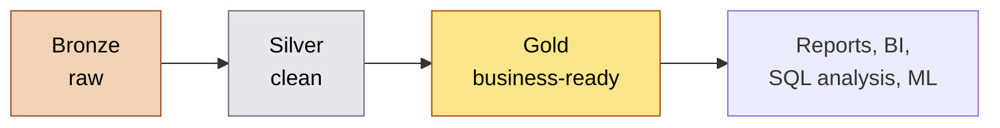
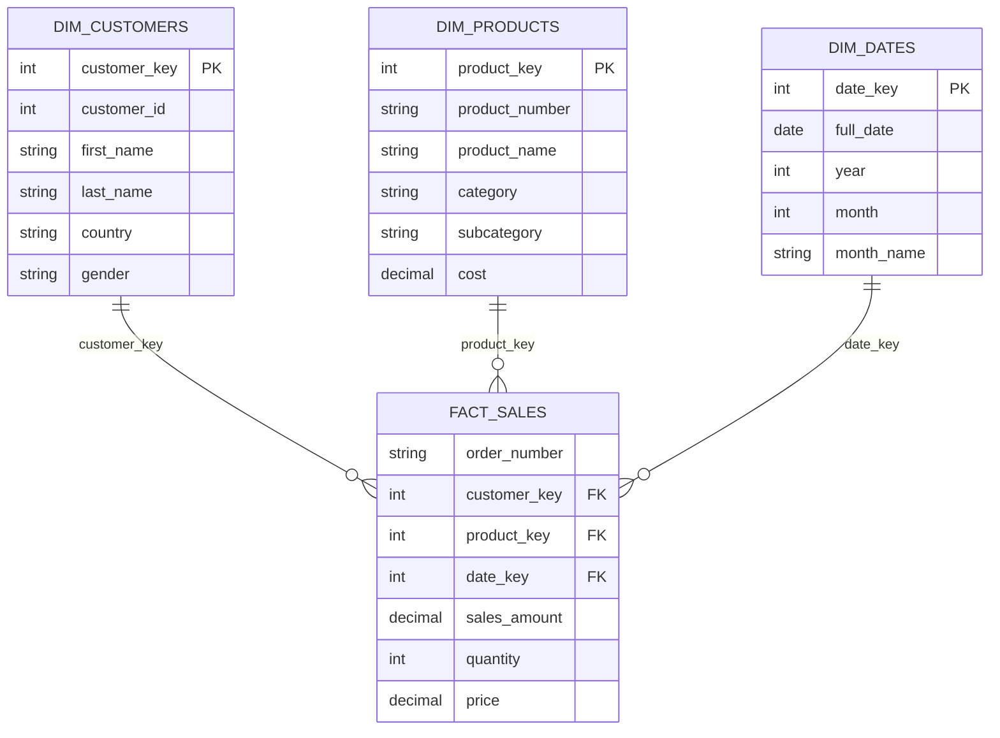
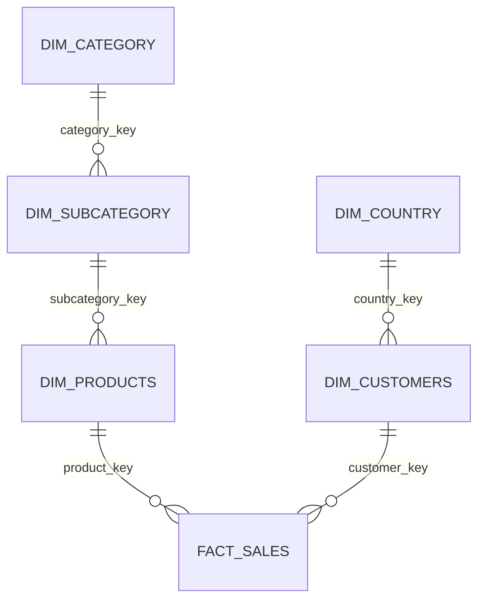
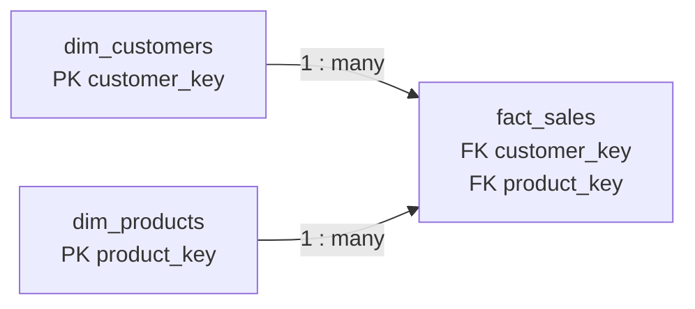
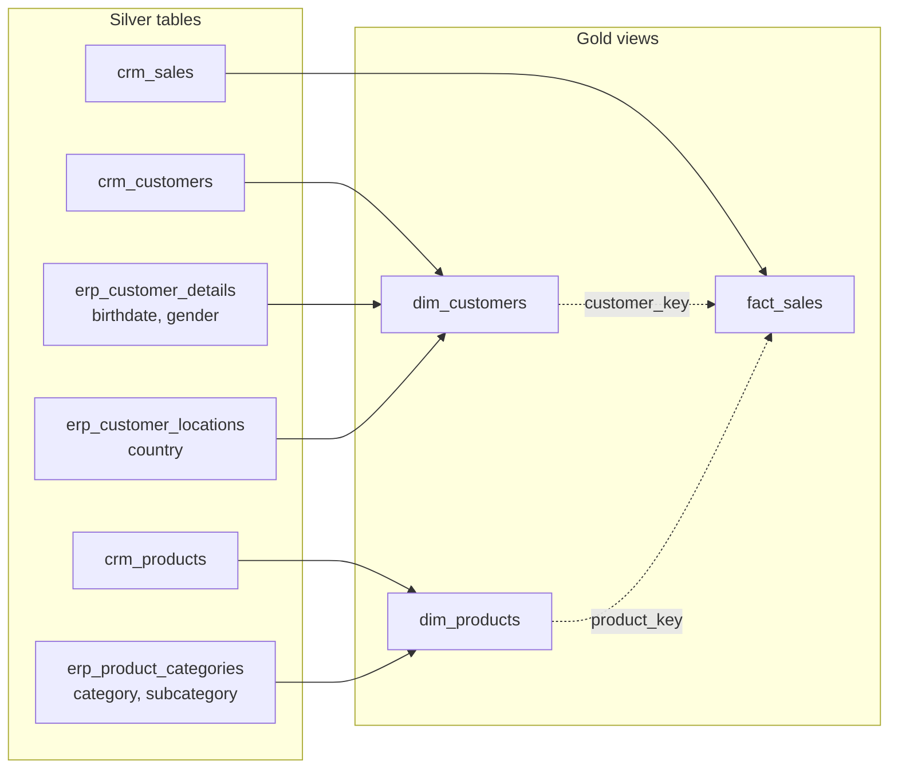

# Gold Layer: Learning Notes

Notes on the gold layer of a medallion architecture, with the data modelling ideas behind it: star and snowflake schemas, facts and dimensions, surrogate keys, data integration and the data catalog. The examples are generic (customers, products, sales) and use SQL Server.

## Contents

1. [What gold is](#what-gold-is)
2. [Data modelling basics](#data-modelling-basics)
3. [Facts vs dimensions](#facts-vs-dimensions)
4. [Star schema](#star-schema)
5. [Snowflake schema](#snowflake-schema)
6. [Star vs snowflake](#star-vs-snowflake)
7. [Relationships between facts and dimensions](#relationships-between-facts-and-dimensions)
8. [Surrogate keys](#surrogate-keys)
9. [Data integration](#data-integration)
10. [Building the gold objects](#building-the-gold-objects)
11. [Checking the gold layer](#checking-the-gold-layer)
12. [Data catalog](#data-catalog)
13. [Other important ideas](#other-important-ideas)
14. [Common mistakes](#common-mistakes)
15. [Summary](#summary)

---

## What gold is

Gold is the last layer. It takes the clean data from silver and turns it into something the business can use directly: integrated, modelled and easy to query.



| | Gold |
|---|---|
| Definition | Business-ready data |
| Objective | Provide data to be consumed for reporting and analytics |
| Object type | Views |
| Load method | None (views store no data) |
| Transformations | Data integration, aggregation, business logic and rules |
| Data modelling | Star schema, aggregated objects, flat tables |
| Audience | Data analysts, business users |

Silver is about **quality** (is the data right?). Gold is about **meaning** (is the data usable?).

### Why views?

- There's nothing to load or schedule, and gold is always in sync with silver.
- No extra storage.
- The trade-off is that the query runs every time someone uses the view. On large data you'd switch to physical tables loaded by a procedure, which is faster to read but needs a load step.

---

## Data modelling basics

Data modelling is deciding **what tables exist and how they connect**. It happens at three levels of detail.

| Level | What it shows | Example |
|---|---|---|
| **Conceptual** | The main things and how they relate, with no detail | Customers place Orders for Products |
| **Logical** | Tables, columns, keys and relationships, without database specifics | `customers(customer_id, name, country)` |
| **Physical** | The real thing: data types, indexes, schemas, constraints | `customer_id INT NOT NULL` in SQL Server |

### Two styles of modelling

| | Normalised (3NF) | Dimensional |
|---|---|---|
| Goal | Avoid repeating data and keep updates safe | Make analysis fast and simple |
| Shape | Many small, related tables | A few wide tables: facts and dimensions |
| Used in | Operational systems (the source databases) | Data warehouses, reporting |
| Query style | Many joins | Few joins |

Source systems are usually normalised because they're built for transactions. A warehouse reshapes the data into a **dimensional model** because it's built for questions like "total sales by country by month".

---

## Facts vs dimensions

Every dimensional model is built from two kinds of table.

| | Fact table | Dimension table |
|---|---|---|
| Answers | **How much?** **How many?** | **Who? What? Where? When?** |
| Contains | Measurements (numbers) and keys pointing at dimensions | Descriptive attributes (text, categories, dates) |
| Size | Many rows, growing fast | Fewer rows, changing slowly |
| Shape | Narrow (few columns) | Wide (many columns) |
| Example | `fact_sales` | `dim_customers`, `dim_products` |
| Used for | Calculating (`SUM`, `COUNT`, `AVG`) | Filtering, grouping, labelling |

A quick rule: if you'd put it in a `SUM()`, it belongs in a fact. If you'd put it in a `GROUP BY` or a `WHERE`, it belongs in a dimension.

### What goes in a fact table

- **Foreign keys** to each dimension (`customer_key`, `product_key`)
- **Measures:** `sales_amount`, `quantity`, `price`
- **Dates** of the event (order, ship, due)
- Sometimes an identifier from the source, such as an order number (called a *degenerate dimension* because it has no table of its own)

### The grain

The **grain** is what one row in the fact table represents. Decide it first, and write it down.

> *One row per order line: one product, bought by one customer, on one order.*

Everything else follows from the grain. Mixing grains in one fact table (some rows per order, some per order line) breaks totals.

### Types of measure

| Type | Meaning | Example |
|---|---|---|
| **Additive** | Can be summed across every dimension | `sales_amount`, `quantity` |
| **Semi-additive** | Can be summed across some dimensions, not time | account balance |
| **Non-additive** | Can't be summed, only averaged or recalculated | `price`, ratios, percentages |

Summing `price` across rows is meaningless. Average it, or calculate `SUM(sales) / SUM(quantity)`.

### Types of fact table

| Type | One row per | Example |
|---|---|---|
| Transaction | Event | Each sale |
| Periodic snapshot | Period | Account balance at the end of each month |
| Accumulating snapshot | Process | An order's progress through stages |

### What goes in a dimension table

- A **surrogate key** (primary key)
- The **business key** from the source (kept for traceability)
- Descriptive attributes: names, categories, locations, statuses
- Wide is fine. Repetition in dimensions is accepted in exchange for simple queries.

---

## Star schema

A star schema puts one fact table in the middle, surrounded by dimension tables, each joined directly to the fact. Drawn out, it looks like a star.



### Why star schemas work well

- **Simple queries:** one join per dimension, no chains.
- **Fast:** fewer joins, and database engines and BI tools are built to expect this shape.
- **Easy to understand:** business users can see "sales" in the middle and "who, what, when" around it.
- **Flexible:** to slice sales a new way, you add a dimension attribute, not a new table structure.

A typical query:

```sql
SELECT
    p.category,
    c.country,
    SUM(f.sales_amount) AS total_sales
FROM gold.fact_sales f
LEFT JOIN gold.dim_customers c ON f.customer_key = c.customer_key
LEFT JOIN gold.dim_products  p ON f.product_key  = p.product_key
GROUP BY p.category, c.country;
```

---

## Snowflake schema

A snowflake schema is a star schema where the dimensions are **normalised**: split into several related tables. The branches make it look like a snowflake.



In the star version, `dim_products` holds `category` and `subcategory` as plain columns. In the snowflake version, those become their own tables that the product table points to.

| Pros | Cons |
|---|---|
| Less repeated data, so smaller dimensions | More tables and more joins |
| Easier to maintain a value in one place | Harder for business users to follow |
| Cleaner when a dimension has real hierarchies | Slower queries, because of the extra joins |

---

## Star vs snowflake

| | Star | Snowflake |
|---|---|---|
| Dimensions | Denormalised, one wide table each | Normalised, split into several tables |
| Joins per query | Few | More |
| Query speed | Faster | Slower |
| Storage | Slightly more (repeated values) | Slightly less |
| Simplicity | Simpler | More complex |
| Maintenance | Repeated values must be updated everywhere | Update in one place |
| Typical choice | **Default for analytics and BI** | When dimension hierarchies are large or shared |

Storage is cheap and query simplicity matters more, so most warehouses use the star schema. Choose snowflake only when there's a strong reason.

---

## Relationships between facts and dimensions

In a star schema every relationship is **one-to-many**, from a dimension to the fact.

- One customer can appear in many sales rows.
- One product can appear in many sales rows.
- Each sales row points to **exactly one** customer and **exactly one** product.



| Term | Meaning |
|---|---|
| **Primary key (PK)** | Uniquely identifies a row in a dimension (`customer_key`) |
| **Foreign key (FK)** | A column in the fact that holds a dimension's primary key |
| **Cardinality** | How many rows on one side relate to the other (here, one-to-many) |

### What can go wrong

- **Orphan fact rows:** a fact row whose key finds nothing in the dimension, so it vanishes from reports that use an inner join.
- **Duplicate dimension keys:** if the dimension has two rows for one key, every matching fact row doubles (a *fan-out*) and totals become too big.
- **Wrong grain:** summing across rows of different detail levels.

### Unknown members

When a fact row has no matching dimension row, don't let the key be NULL. Give the dimension a row that stands for "unknown" (for example key `-1`, name `'Unknown'`) and point those facts at it. Reports then show an "Unknown" group instead of silently dropping the rows.

---

## Surrogate keys

A **surrogate key** is a generated ID that exists only in the warehouse. It has no business meaning.

The alternative is a **business key** (natural key): the ID the source system uses, such as a customer number.

| | Surrogate key | Business key |
|---|---|---|
| Origin | Made by the warehouse | Comes from the source |
| Meaning | None | Meaningful to the business |
| Example | `customer_key = 1042` | `customer_number = 'AW00011000'` |
| Stability | Under your control | Can change or be reused by the source |

### Why use them

- **Independence from the source:** if the source changes its ID format, the model doesn't break.
- **Combining sources:** two systems may use clashing IDs for different things. A surrogate key is unique across all of them.
- **Speed:** a small integer joins faster than a long text key.
- **History:** if you keep several versions of a dimension row (slowly changing dimensions), each version needs its own unique key.

### How to create one

In a view, with a window function:

```sql
ROW_NUMBER() OVER (ORDER BY customer_id) AS customer_key
```

This numbers the rows 1, 2, 3 and so on. The catch: it's **recalculated on every query**. If customers are added or removed, the numbers can shift. That's fine when the fact and dimension views are always read together, but it's not safe if you store a `customer_key` anywhere else.

In a physical table, use an identity column. The numbers are assigned once and stay put:

```sql
CREATE TABLE gold.dim_customers (
    customer_key INT IDENTITY(1,1) PRIMARY KEY,
    customer_id  INT,
    ...
);
```

### Using them in the fact table

The fact table looks up each dimension's surrogate key by joining on the business key, then keeps only the surrogate key:

```sql
SELECT
    s.order_number,
    p.product_key,
    c.customer_key,
    s.sales_amount
FROM silver.sales s
LEFT JOIN gold.dim_products  p ON s.product_number = p.product_number
LEFT JOIN gold.dim_customers c ON s.customer_id    = c.customer_id;
```

---

## Data integration

Gold is where data from **different source systems is combined** into one model. Silver cleaned each source on its own. Gold brings them together.



Here three customer tables become one `dim_customers`, two product tables become one `dim_products`, and the sales table becomes `fact_sales`, which picks up the surrogate keys from the two dimensions.

### The steps of integration

1. **Choose the main table.** Usually the system that owns the entity (the CRM for customers). Everything else is joined to it.
2. **Join on a business key,** which is why the key cleaning in silver matters. If one system writes `NAS00011000` and another `00011000`, they can't be joined until they match.
3. **Use a `LEFT JOIN`** from the main table, so records missing from the other systems are kept, not dropped.
4. **Resolve conflicts.** When two systems describe the same thing differently, pick a rule and write it down.
5. **Give columns business-friendly names.**
6. **Create the surrogate key.**
7. **Check the result** for duplicates and missing matches.

### Resolving conflicts: choose a master source

```sql
-- gender comes from both systems: the CRM is the master, the ERP is the fallback
CASE
    WHEN crm.gender != 'n/a' THEN crm.gender
    ELSE COALESCE(erp.gender, 'n/a')
END AS gender
```

The rule (which system wins) is a business decision. Agree it with the data owners and record it in the documentation.

### Joins in gold

| Join | Behaviour | Use in gold |
|---|---|---|
| `LEFT JOIN` | Keeps every row from the main table | **Default** for building dimensions and facts |
| `INNER JOIN` | Keeps only rows that match on both sides | Risky: silently drops rows |
| `FULL JOIN` | Keeps everything from both | Only when you need to compare two sources |

### Fan-out check

If a join matches one row to several rows, the result multiplies. The row count after the join must equal the row count of the main table. If it's higher, something has duplicates.

---

## Building the gold objects

### Dimension view

```sql
CREATE VIEW gold.dim_customers AS
SELECT
    ROW_NUMBER() OVER (ORDER BY c.customer_id) AS customer_key,   -- surrogate key
    c.customer_id,
    c.customer_number,
    c.first_name,
    c.last_name,
    l.country,
    c.marital_status,
    CASE
        WHEN c.gender != 'n/a' THEN c.gender
        ELSE COALESCE(d.gender, 'n/a')
    END AS gender,
    d.birthdate
FROM silver.crm_customers c
LEFT JOIN silver.erp_customer_details   d ON c.customer_number = d.customer_number
LEFT JOIN silver.erp_customer_locations l ON c.customer_number = l.customer_number;
GO
```

### Fact view

```sql
CREATE VIEW gold.fact_sales AS
SELECT
    s.order_number,
    p.product_key,         -- keys from the dimensions
    c.customer_key,
    s.order_date,
    s.shipping_date,
    s.due_date,
    s.sales_amount,
    s.quantity,
    s.price
FROM silver.crm_sales s
LEFT JOIN gold.dim_products  p ON s.product_number = p.product_number
LEFT JOIN gold.dim_customers c ON s.customer_id    = c.customer_id;
GO
```

Create the dimension views first, since the fact view depends on them.

### Naming

| Pattern | Meaning | Example |
|---|---|---|
| `dim_` | Dimension | `dim_customers` |
| `fact_` | Fact | `fact_sales` |
| `report_` | Report or aggregate | `report_sales_monthly` |
| `<table>_key` | Surrogate key | `customer_key` |

Use plain business names for columns (`first_name`, not `cst_firstname`), because this is the layer people read.

### Current rows only

If a source keeps history (several versions of a product), a dimension often wants only the current version, unless you're deliberately tracking history. Filter to the current rows (for example, where the end date is empty). Otherwise a join from sales matches every version and multiplies the rows.

---

## Checking the gold layer

Validation here is about **integration**, not cleaning.

**Duplicate keys in a dimension** (expect no rows):
```sql
SELECT customer_key, COUNT(*)
FROM gold.dim_customers
GROUP BY customer_key
HAVING COUNT(*) > 1;
```

**Duplicates introduced by a join** (the business key should still be unique):
```sql
SELECT customer_id, COUNT(*)
FROM gold.dim_customers
GROUP BY customer_id
HAVING COUNT(*) > 1;
```

**Row counts** (the fact should have as many rows as its silver source):
```sql
SELECT COUNT(*) FROM gold.fact_sales;
SELECT COUNT(*) FROM silver.crm_sales;
```

**Foreign key integrity** (expect no rows: every fact row finds its dimensions):
```sql
SELECT *
FROM gold.fact_sales f
LEFT JOIN gold.dim_customers c ON f.customer_key = c.customer_key
WHERE c.customer_key IS NULL;
```

**Do the totals match?** Compare a total in gold with the same total in silver:
```sql
SELECT SUM(sales_amount) FROM gold.fact_sales;
SELECT SUM(sales_amount) FROM silver.crm_sales;
```

**Conflicting values** between sources (to decide the master rule):
```sql
SELECT DISTINCT c.gender AS crm_gender, d.gender AS erp_gender
FROM silver.crm_customers c
LEFT JOIN silver.erp_customer_details d ON c.customer_number = d.customer_number;
```

---

## Data catalog

A **data catalog** is the documentation of what every object in gold *means*. It's what lets someone who wasn't there understand the data without asking.

For each table:
- Name and purpose
- What one row represents (the grain)
- Where the data comes from
- Owner

For each column:
- Name
- Data type
- Description in business terms
- Allowed or example values

An example entry:

**`gold.dim_customers`**: one row per customer, combining CRM and ERP data.

| Column | Type | Description |
|---|---|---|
| `customer_key` | INT | Surrogate key identifying each customer record in the dimension |
| `customer_id` | INT | Unique numeric ID assigned to each customer in the source |
| `country` | NVARCHAR(50) | Country of residence, for example `Germany` |
| `marital_status` | NVARCHAR(50) | `Married`, `Single` or `n/a` |
| `gender` | NVARCHAR(50) | `Male`, `Female` or `n/a` |
| `birthdate` | DATE | Date of birth, empty if unknown or invalid |

A good catalog also records:
- **Business rules** (for example `sales_amount = quantity x price`)
- **Which source wins** when systems disagree
- **Known data issues** (for example, one category missing from the reference data)
- **Lineage:** which silver tables feed each gold object

### Other documentation for gold

| Document | What it shows |
|---|---|
| **Data model** | The star schema diagram: tables, keys, relationships |
| **Data catalog** | Every table and column explained |
| **Data flow (lineage)** | How data moves from source to gold |
| **Data integration diagram** | How source tables relate and join |

Keep all of them in version control (Git) with the code.

---

## Other important ideas

### Slowly changing dimensions (SCD)

Dimension values change over time (a customer moves country). The type decides what happens to the old value:

| Type | What happens | History |
|---|---|---|
| SCD 0 | Never changes | None |
| SCD 1 | Overwrite with the new value | None |
| SCD 2 | Add a new row, with start and end dates and a current flag | Full |

This is exactly why surrogate keys exist: in SCD 2, one customer has several dimension rows, each needing its own key.

### Conformed dimensions

When several fact tables share the same dimension (a `dim_customers` used by sales and by returns), it should be the **same table** for both. Then numbers from different facts can be compared by customer.

### Role-playing dimensions

One dimension used in several roles. A sales fact has an order date, a ship date and a due date, and all three can point to the same `dim_dates` table, each under a different role.

### Date dimension

A table with one row per day and columns like year, month, month name, quarter and weekday. It lets reports group by month without calculating it in every query.

### Aggregated and flat objects

Besides the star schema, gold can hold:

| Object | What it is | Use |
|---|---|---|
| **Aggregated** | Pre-summarised data, such as monthly sales by region | Dashboards that always ask the same thing |
| **Flat table** | One wide table with everything already joined | Users who want a single table in Excel or a BI tool |

Both are built **from** the star schema, not instead of it.

### Views vs tables in gold

| | View | Table |
|---|---|---|
| Stores data | No | Yes |
| Always current | Yes | Only after a load |
| Read speed | Slower on big data | Faster |
| Needs a load | No | Yes |
| Stable surrogate keys | No (recalculated) | Yes (with `IDENTITY`) |

### Security

Gold is what users see, so access is normally granted here and not on bronze or silver. Giving analysts access to gold only keeps raw and half-cleaned data out of reach.

---

## Common mistakes

| Mistake | What happens | Fix |
|---|---|---|
| Cleaning in gold | Quality issues are hidden at the wrong layer | Fix them in silver |
| `INNER JOIN` to dimensions | Rows with missing dimension data disappear | `LEFT JOIN`, and use unknown members |
| Joining to a dimension with several versions per key | Fan-out: totals too high | Filter the dimension to current rows |
| No grain decided | Mixed row meanings, wrong totals | Write the grain down first |
| Summing a non-additive measure (`price`) | Meaningless numbers | Average it, or recompute from sums |
| Business keys in the fact table | Model depends on source IDs | Use surrogate keys |
| Putting descriptive text in the fact | Wide fact, repeated text | Move it to a dimension |
| Different rules for the master source in different places | Inconsistent results | Decide once, document it |
| Storing view-generated surrogate keys elsewhere | Keys shift later | Use a physical table with `IDENTITY` |
| Skipping the catalog | Nobody knows what columns mean | Document tables, columns, rules and issues |
| Technical column names | Users can't read them | Business-friendly names |

---

## Summary

- Gold = integrated, modelled, business-ready data, usually built as **views** over silver.
- A **dimensional model** has two kinds of table: **facts** (measures: how much) and **dimensions** (context: who, what, when, where).
- A **star schema** joins dimensions directly to one fact. A **snowflake schema** normalises the dimensions into more tables. Use a star by default, because it's simpler and faster.
- Relationships are **one-to-many** from dimension to fact, through **foreign keys** holding the dimension's **surrogate key**.
- **Surrogate keys** make the model independent of the source systems and support history.
- **Integration** means joining the cleaned sources on business keys, choosing a master source for conflicts, and using `LEFT JOIN` so nothing is lost.
- Check for duplicates, row counts, orphan keys and matching totals.
- The **data catalog**, the data model, the data flow and the integration diagram are part of the deliverable, because gold is what other people read.
