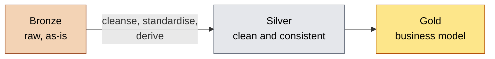

# Silver Layer: Learning Notes

Notes on the silver layer of a medallion architecture, using SQL Server. The examples are generic (customers, products, sales) and come from the kinds of problems you hit when cleaning real source data.

## Contents

1. [What silver is](#what-silver-is)
2. [How to work: check, fix, check again](#how-to-work-check-fix-check-again)
3. [Problems and fixes](#problems-and-fixes)
4. [Loading pattern](#loading-pattern)
5. [Checking the silver layer](#checking-the-silver-layer)
6. [Common mistakes](#common-mistakes)
7. [Summary](#summary)

---

## What silver is

Silver is the second layer. It takes the raw data from bronze and makes it **clean, consistent and trustworthy**, without yet changing its shape. Each silver table usually mirrors one bronze table, only cleaned.



| | Silver |
|---|---|
| Definition | Clean and standardised data |
| Objective | Prepare the data for analysis (an intermediate layer) |
| Object type | Tables |
| Load method | Batch, full load (truncate and insert) |
| Transformations | Cleansing, standardisation, normalisation, derived columns, enrichment |
| Data model | None yet. Same structure as the source |
| Audience | Data engineers, data analysts |

Silver fixes **data quality**. It doesn't combine sources or apply reporting logic. That happens in gold.

---

## How to work: check, fix, check again

For every table, the same loop works well:

1. **Explore** the bronze table (`SELECT *`) and understand each column.
2. **Check** for problems with a query that should return no rows.
3. **Write the fix** in a `SELECT`.
4. **Check the fixed result** to prove the fix works, before saving anything.
5. **Insert** into silver, then run the checks on the silver table itself.

Step 4 is easy to skip, but it's the one that stops you saving a broken fix. A CTE lets you test the cleaned output in one query:

```sql
WITH cleaned AS (
    SELECT
        -- ... your cleaning logic here ...
    FROM bronze.some_table
)
SELECT *
FROM cleaned
WHERE /* conditions that should never be true */;
```

If it returns no rows, the fix works. Then change the last line to `SELECT * FROM cleaned` and put `INSERT INTO silver.some_table (...)` in front.

Write each check in the same shape, so the results are easy to read:

```sql
-- check for <problem> in <column>
-- Expectation: no results
SELECT ...
```

---

## Problems and fixes

### 1. Duplicate records

**Problem:** the same primary key appears more than once, for example several versions of a customer record.

**Fix:** rank the rows per key, newest first, and keep only rank 1.

```sql
SELECT *
FROM (
    SELECT *,
           ROW_NUMBER() OVER (PARTITION BY customer_id ORDER BY created_date DESC) AS flag_last
    FROM bronze.customers
    WHERE customer_id IS NOT NULL
) t
WHERE flag_last = 1;
```

A window function can't be used directly in `WHERE`, because `WHERE` runs before `SELECT` and the alias doesn't exist yet. Put the ranking in a subquery or CTE and filter outside it.

*Check:*
```sql
SELECT customer_id, COUNT(*)
FROM silver.customers
GROUP BY customer_id
HAVING COUNT(*) > 1 OR customer_id IS NULL;
```

### 2. Missing primary keys

**Problem:** rows with a NULL key can't be identified or joined.

**Fix:** remove them **before** ranking (`WHERE customer_id IS NOT NULL` inside the subquery). `PARTITION BY` puts all the NULLs into one group, so if you filter afterwards you still keep one NULL row.

### 3. Unwanted spaces

**Problem:** leading or trailing spaces in text, so `'Sara '` and `'Sara'` look different to a join or a `GROUP BY`.

**Fix:** `TRIM(column)`.

*Check:*
```sql
SELECT first_name
FROM bronze.customers
WHERE first_name != TRIM(first_name);
```

If a value looks clean but doesn't match, it may hold a hidden carriage return from the end of a CSV line. `TRIM` doesn't remove those, but `REPLACE(REPLACE(col, CHAR(13), ''), CHAR(10), '')` does. The last column of a file is the most likely to have it.

### 4. Inconsistent codes and abbreviations

**Problem:** short codes (`M`, `F`, `S`) or mixed spellings (`US`, `USA`, `United States`) for the same thing.

**Fix:** map them to readable, consistent values with `CASE`. Use `UPPER(TRIM(...))` so case and spaces don't matter.

```sql
CASE
    WHEN UPPER(TRIM(gender)) IN ('F', 'FEMALE') THEN 'Female'
    WHEN UPPER(TRIM(gender)) IN ('M', 'MALE')   THEN 'Male'
    ELSE 'n/a'
END AS gender
```

*Always look first* at what the column really contains, and build the mapping from that:
```sql
SELECT DISTINCT gender FROM bronze.customers;
```

### 5. Missing or unknown values

**Problem:** NULLs and blanks in a text or number column.

**Fix:** choose a sensible default and apply it consistently.

| Column type | Typical default |
|---|---|
| Descriptive text (gender, country, status) | `'n/a'` |
| Numbers where missing really means zero (cost) | `ISNULL(col, 0)` |
| Dates | Leave as NULL. A made-up date is worse than a missing one |

This is a business decision, not a technical one, so note down which defaults you chose and why.

### 6. Dates stored as integers

**Problem:** dates like `20250103` held in an `INT` column, with `0` or short values for bad entries.

**Fix:** turn the bad values into NULL, then cast to a real date. SQL Server can't cast `INT` straight to `DATE`, so go through `VARCHAR`.

```sql
CASE
    WHEN order_dt = 0 OR LEN(order_dt) != 8 THEN NULL
    ELSE CAST(CAST(order_dt AS VARCHAR) AS DATE)
END AS order_date
```

*Check (on bronze, where the dates are still integers):*
```sql
SELECT order_dt
FROM bronze.sales
WHERE order_dt <= 0 OR order_dt IS NULL OR LEN(order_dt) != 8
   OR order_dt > 20500101 OR order_dt < 19000101;
```

In silver the column is a real `DATE`, so the same check must compare against date strings (`'2050-01-01'`), not integers, or it will fail with a type error.

### 7. Invalid date order

**Problem:** an end date earlier than its start date, or an order that shipped before it was placed.

*Check:*
```sql
SELECT * FROM bronze.sales WHERE order_dt > ship_dt OR order_dt > due_dt;
SELECT * FROM bronze.products WHERE end_dt < start_dt;
```

**Fix for versioned records (slowly changing history):** don't trust the stored end date. Derive it from the next version's start date. Each version ends the day before the next one starts, and the latest version stays NULL (still current).

```sql
CAST(LEAD(start_dt) OVER (PARTITION BY product_key ORDER BY start_dt) - 1 AS DATE) AS end_dt
```

`- 1` works on `DATETIME` columns. On a `DATE` column it fails, so `DATEADD(DAY, -1, ...)` is safer. This only works if a product's versions don't overlap.

### 8. Out-of-range values

**Problem:** impossible values, such as a birthdate in the future or a customer over 100 years old.

**Fix:** decide per case. Future dates are clearly wrong and can become NULL. Very old dates are usually placeholders, but how to handle them is a business call.

```sql
CASE WHEN birth_date > GETDATE() THEN NULL ELSE birth_date END AS birth_date
```

### 9. Business rules on numbers

**Problem:** values that break a rule, such as `sales = quantity × price`, or negative and zero amounts.

*Check:*
```sql
SELECT DISTINCT sales, quantity, price
FROM bronze.sales
WHERE sales != quantity * price
   OR sales IS NULL OR quantity IS NULL OR price IS NULL
   OR sales <= 0 OR quantity <= 0 OR price <= 0;
```

**Fix (an example set of rules):**
- if sales is wrong, derive it from quantity and price
- if price is zero or NULL, derive it from sales and quantity
- if price is negative, make it positive

```sql
CASE
    WHEN sales IS NULL OR sales <= 0 OR sales != quantity * ABS(price)
        THEN quantity * ABS(price)
    ELSE sales
END AS sales,

CASE
    WHEN price IS NULL OR price = 0 THEN sales / NULLIF(quantity, 0)
    WHEN price < 0                  THEN ABS(price)
    ELSE price
END AS price
```

`NULLIF(quantity, 0)` turns a zero into NULL so you don't get a divide-by-zero error. A row where several columns are bad at once can't always be repaired. Look for leftovers in the check afterwards. Rules like these come from the business, so agree them with whoever owns the data.

### 10. Keys that don't match across sources

**Problem:** the same customer has a different ID format in two systems, so they can't be joined.

| Mismatch | Example | Fix |
|---|---|---|
| Extra prefix | `NAS00011000` vs `00011000` | `CASE WHEN id LIKE 'NAS%' THEN SUBSTRING(id, 4, LEN(id)) ELSE id END` |
| Extra separator | `AB-00011000` vs `AB00011000` | `REPLACE(id, '-', '')` |
| Different separator | `CO-RF` vs `CO_RF` | `REPLACE(id, '-', '_')` |

*Check that the cleaned keys now match:*
```sql
SELECT REPLACE(id, '-', '') AS id
FROM bronze.locations
WHERE REPLACE(id, '-', '') NOT IN (SELECT customer_key FROM silver.customers);
```

### 11. Derived columns

**Problem:** one column holds two pieces of information, for example a product key like `CO-RF-FR-R92B-58` that contains a category (`CO-RF`) and a product code (`FR-R92B-58`).

**Fix:** split it into two columns, each usable as a join key.

```sql
REPLACE(SUBSTRING(product_key, 1, 5), '-', '_') AS category_id,
SUBSTRING(product_key, 7, LEN(product_key))     AS product_key
```

The silver table needs the new column too.

### 12. Orphan records (referential integrity)

**Problem:** a fact row points to a customer or product that doesn't exist in the other table.

*Check:*
```sql
SELECT *
FROM silver.sales
WHERE product_key NOT IN (SELECT product_key FROM silver.products);
```

`NOT IN` returns nothing at all if the subquery contains a NULL, and it returns everything if the subquery is empty. `NOT EXISTS` avoids the NULL problem:

```sql
SELECT *
FROM silver.sales s
WHERE NOT EXISTS (SELECT 1 FROM silver.products p WHERE p.product_key = s.product_key);
```

**What to do with orphans:** keep them. They're real sales. Join with a `LEFT JOIN` later so they survive, and show the missing details as `'n/a'`. An `INNER JOIN` would silently drop them. Don't make up the missing reference data. Report it to the data owner and document it as a known issue.

---

## Loading pattern

Silver is a **full load**: empty the table, then insert the cleaned result.

```sql
TRUNCATE TABLE silver.customers;

INSERT INTO silver.customers (customer_id, first_name, ...)
SELECT customer_id, TRIM(first_name), ...
FROM bronze.customers;
```

- The columns are matched **by position**, not by name. The column list and the `SELECT` have to line up in count, order and compatible types.
- The silver table must already exist. `INSERT` doesn't create it.
- `TRUNCATE` first, or every re-run duplicates the rows.
- The silver column types should match the cleaned values (a column cleaned into a date must be `DATE` in the table, or SQL Server converts it back).

### Technical column

Add a column that records when each row was loaded:

```sql
dwh_create_date DATETIME2 DEFAULT GETDATE()
```

It fills itself in, so leave it out of the `INSERT` list.

### Stored procedure with timing

Wrap the loads in a stored procedure so the whole layer reloads with one command (`EXEC silver.load_silver;`). A good one times each table and reports errors:

```sql
SET @start_time = GETDATE();
PRINT '>> Truncating Table: silver.customers';
TRUNCATE TABLE silver.customers;
PRINT '>> Inserting Data Into: silver.customers';
INSERT INTO silver.customers (...)
SELECT ...;
SET @end_time = GETDATE();
PRINT 'Load Duration: ' + CAST(DATEDIFF(second, @start_time, @end_time) AS NVARCHAR) + ' seconds';
```

Declare the timers once at the top (`DECLARE @start_time DATETIME, @end_time DATETIME;`) and wrap the whole body in `BEGIN TRY ... END TRY BEGIN CATCH ... END CATCH`, printing `ERROR_MESSAGE()` in the catch block.

### Load order

Load the tables that others depend on first. Sales checks look up keys in customers and products, so load those two before sales.

---

## Checking the silver layer

After loading, rerun the same checks against the silver tables. Every one should return no rows, apart from expected leftovers.

| Check | Expect in silver |
|---|---|
| Duplicate or NULL primary keys | no rows |
| Unwanted spaces | no rows |
| `SELECT DISTINCT` on code columns | only the full, standardised names and `n/a` |
| Out-of-range dates | no rows (NULLs are expected where bad values were removed) |
| Date order | no rows |
| Business rules (sales = quantity × price) | no rows |
| Keys that don't match across tables | no rows, or a documented exception |
| Row count vs bronze | slightly lower, because duplicates and NULL keys were removed |

Also make sure the table isn't just empty. An empty table passes every "no rows" check.

```sql
SELECT
    (SELECT COUNT(*) FROM bronze.customers) AS bronze_rows,
    (SELECT COUNT(*) FROM silver.customers) AS silver_rows;
```

---

## Common mistakes

| Mistake | What happens | Fix |
|---|---|---|
| Using a window function in `WHERE` | "Invalid column name" | Wrap it in a subquery or CTE |
| Filtering NULL keys after ranking | One NULL row survives | Filter before the `ROW_NUMBER()` |
| Re-running the `CREATE TABLE` scripts | `DROP TABLE` wipes the data, so later checks suddenly fail | Reload every table afterwards |
| No `TRUNCATE` before the insert | Duplicate rows on every run | Truncate first |
| Silver column type doesn't match the cleaned value | Dates silently turn back into datetimes | Define the right type in `CREATE TABLE` |
| Integer date checks on a `DATE` column | Type error | Compare against date strings |
| `NOT IN` with NULLs or an empty list | Returns nothing, or everything | Use `NOT EXISTS`, and check the subquery has data |
| `INNER JOIN` to a reference table with gaps | Rows disappear silently | `LEFT JOIN` and default to `'n/a'` |
| Making up missing data | False facts in the warehouse | Keep NULL or `'n/a'`, and report it |
| Not noting the decisions | Nobody knows why a default was chosen | Write the rule in a comment above the fix |

---

## Summary

- Silver = bronze, cleaned. Same shape, trustworthy values.
- Work in a loop: check → fix → check the fix → insert → check silver.
- The core techniques are `ROW_NUMBER()` for duplicates, `TRIM` for spaces, `CASE` for standardising, `ISNULL` for defaults, `CAST` for types and `LEAD` for date ranges.
- Business rules (defaults, "latest record wins", how to repair prices) are decisions, so write them down.
- Don't delete rows just because reference data is missing. Keep them and handle the gap when you join.
- Full load every time: truncate, then insert, wrapped in a stored procedure with timing and error handling.
